# Database schema

The live `phaser_june` as it was on 2026-11-26: PostgreSQL 17.5, PostGIS 3.5.2. The cc-schema-map mission mapped it read-only. Every fact here comes from one of two places:

- a query in the mission's log (`/srv/critter-ai/agent-state/missions/cc-schema-map/queries/`), cited by its number, e.g. [08];
- the code at `file:line` on `origin/main` `62c63c32`.

`db/schema.sql` is the hand-kept baseline of the objects the app defines. This page maps everything the game and its scripts depend on. `db/analysis/schema-check.sql` reprints the live definitions so both can be checked (see [Schema check](#schema-check)). Connection routes and credentials: `docs/DATABASE_ACCESS.md`.

No table here holds data about people. M13 dropped the last player tables on 2026-11-15.

## At a glance

Three schemas: `public`, `oneearth` and `natural_earth`. They hold 11 tables and materialized views and 5 sequences, plus PostGIS's own objects. There are no functions, triggers, rules, policies, enum or domain types, publications or foreign tables of the project's own [06]. Row counts are exact [08]; sizes include indexes and TOAST [02].

| Relation | Kind | Rows | Size | Written by | Read by |
|---|---|---|---|---|---|
| `species` | table | 76 | 168 kB | content build | the game's pool and places, both views, scripts, practice SQL |
| `species_deduction_clues` | table | 3,653 | 2.3 MB | content build | the game's pool, both views (which animals are playable), practice SQL |
| `species_facts` | table | 491 | 384 kB | content build | the game's pool, practice SQL |
| `content_sources` | table | 16 | 96 kB | content build | the game's pool |
| `habitat_colormap` | table | 82 | 32 kB | nothing (kept by the owner) | nothing |
| `iucn` | table | 202 | 71 MB | `npm run iucn -- import` | both views, `content -- ranges`, practice SQL |
| `clue_match_ranges` | materialized view | 76 | 296 kB | `REFRESH` by hand | `/api/clue-game/range`, `/api/clue-game/ranges` |
| `clue_match_places` | materialized view | 5 | 432 kB | `REFRESH` by hand | `/api/places`, `/api/places/outline` |
| `natural_earth.countries` | table | 258 | 7.9 MB | `scripts/import-natural-earth.mjs` | `clue_match_places`, `content -- ranges`, `clue:world-map` |
| `oneearth.oneearth_bioregion` | table | 827 | 66 MB | an import outside the repo | `content -- ranges`, practice SQL |
| `oneearth.eco_sym_colors` | table | 118 | 24 kB | nothing (kept by the owner) | nothing |

The whole database is 167 MB [01]. Each serial column owns its sequence: `species_id_seq`, `species_deduction_clues_id_seq`, `species_facts_id_seq`, `content_sources_id_seq` and `iucn_ogc_fid_seq`. Each sequence's `last_value` equals its table's `max(id)` (`max(ogc_fid)` for `iucn`) [08]. The content build resets the four content tables' sequences after loading them (`scripts/content.ts:36`, called at 213-216). `iucn_ogc_fid_seq` advances through its column default: `npm run iucn -- import` inserts without `ogc_fid` (`scripts/iucn.ts:135`).

The nightly backup, `pg_dump` (`deploy/backup/pg-backup.sh:20`), reads every table once a night at 03:15 UTC. The two kept tables' latest scans are that dump's. `oneearth.eco_sym_colors` was last read through its index on 2026-09-25, and `habitat_colormap` never has been [02].

## Content tables (`public`)

`npm run content -- build` writes these from `db/content/` in one transaction (`scripts/content.ts:209-217`):

1. It deletes every clue and fact (`:210-211`).
2. It upserts `content_sources`, `species`, the clues and the facts by `id` (`load`, `:28-37`).

Ids are stable: a clue's or fact's id is its species id × 100 plus its position in the profile (`src/clueGame/profiles.ts:430`, `:442`). Every row follows that rule today [22].

### `species`

One row per animal. 76 rows, and every one is playable: each has clues and a range row [08].

| Column | Type | Null | Default |
|---|---|---|---|
| `id` | integer | not null | `nextval('species_id_seq')` |
| `iucn_id` | bigint | not null | |
| `scientific_name`, `common_name` | text | not null | |
| `class`, `taxon_order`, `family`, `genus` | text | null (none are) | |
| `conservation_code` | text | null (none are) | |
| `created_at`, `updated_at` | timestamptz | not null | `now()` |
| `redlist_url` | text | null (none are) | |
| `photo_url`, `photo_credit`, `photo_license`, `photo_page` | text | null (2 rows have no photo) | |

- **Keys:** `species_pkey` PRIMARY KEY (`id`); `species_iucn_id_key` UNIQUE (`iucn_id`).
- **Links:** `iucn_id` joins `iucn.id_no`, with no foreign key, because one animal has several polygons. All 76 ids have polygons and every polygon belongs to a species [08].
- **Column order** in the table: `created_at` and `updated_at` sit after `conservation_code`, before `redlist_url` [03], as `db/schema.sql` lists them.
- **Read by:**
  - `src/lib/cluePool.ts:13-16` (`GET /api/clue-game/pool`);
  - `src/lib/places.ts:21-23` (the place card's names);
  - the `ranges` step of both views in `db/schema.sql`;
  - practice SQL `db/analysis/clue-match/01`–`06`.
- **Written by:** `scripts/content.ts:214`. The build never sets `created_at` or `updated_at`, and nothing reads them. 48 of 76 rows still have `updated_at = created_at`, and the newest `updated_at` is 2026-09-30, though the build has rewritten rows since [08]. See the plan's finding F3.

### `species_deduction_clues`

The clues: one row per clue, 3,653 rows.

| Column | Type | Null | Default |
|---|---|---|---|
| `id` | integer | not null | `nextval(...)` |
| `category` | text | not null | |
| `label` | text | not null | |
| `compare_tags` | text[] | null (none are; 612 are empty) | |
| `reveal_order` | smallint | not null | `1` |
| `is_filtering` | boolean | not null | `true` |
| `created_at` | timestamptz | not null | `now()` |
| `species_id` | integer | not null | |
| `source_key`, `source_url` | text | null (no `source_key` is) | |

That is the table's physical column order [03], and `db/schema.sql` lists the columns in the same order.

- **Keys:**
  - `species_deduction_clues_pkey` PRIMARY KEY (`id`);
  - `species_deduction_clues_species_id_fkey` FOREIGN KEY (`species_id`) REFERENCES `species(id)` ON DELETE CASCADE;
  - `species_deduction_clues_source_key_fkey` FOREIGN KEY (`source_key`) REFERENCES `content_sources(key)`;
  - `species_deduction_clues_category_check`: `category` is one of `habitat`, `morphology`, `diet`, `behavior`, `reproduction`, `taxonomy`, `key_fact`, `geography`, `conservation` (`src/clueGame/categories.ts:5`).
- **Indexes:**
  - `uq_deduction_clues_species_cat_order` UNIQUE (`species_id, category, reveal_order`);
  - `ix_deduction_clues_species` (`species_id`) and `ix_deduction_clues_category` (`species_id, category`). Both are leading parts of the unique index (finding F4);
  - `ix_deduction_clues_compare` GIN (`compare_tags`), used by practice SQL.
- **Read by:**
  - `src/lib/cluePool.ts:17-19`;
  - the `playable` step of both views in `db/schema.sql`;
  - practice SQL `01`–`06`.
- **Written by:** `scripts/content.ts:211` (delete) and `:215` (insert). The most clues one animal has is 79 [22]: the id rule allows 100 (finding F2).

### `species_facts`

The fun facts the field guide shows: 491 rows.

| Column | Type | Null | Default |
|---|---|---|---|
| `id` | integer | not null | `nextval(...)` |
| `species_id` | integer | not null | |
| `category` | text | not null | |
| `fact_text` | text | not null | |
| `sort_order` | smallint | not null | `1` |
| `source_key`, `source_url` | text | null (no `source_key` is) | |

- **Keys:**
  - `species_facts_pkey` PRIMARY KEY (`id`);
  - `species_facts_species_id_category_sort_order_key` UNIQUE (`species_id, category, sort_order`);
  - `species_facts_species_id_fkey` FOREIGN KEY (`species_id`) REFERENCES `species(id)` ON DELETE CASCADE;
  - `species_facts_source_key_fkey` FOREIGN KEY (`source_key`) REFERENCES `content_sources(key)`.
- **`category`:** no CHECK. The build only accepts `key_fact`, `behavior`, `diet_prey`, `diet_flora`, `life_description` and `threat` (`src/clueGame/profiles.ts:318`), and those six are the only values [08].
- **Indexes:** `ix_species_facts_species` (`species_id`) and `ix_species_facts_category` (`species_id, category`). Both are leading parts of the unique key (finding F4).
- **Read by:** `src/lib/cluePool.ts:20-22`; practice SQL `01` and `05`.
- **Written by:** `scripts/content.ts:210` and `:216`. The most facts one animal has is 14 [22].

### `content_sources`

Where facts come from, tier 1 (the IUCN Red List) first. 16 rows: 2 in tier 1, 7 in tier 2, 5 in tier 3 and 2 in tier 4 [08].

| Column | Type | Null | Default |
|---|---|---|---|
| `id` | integer | not null | `nextval(...)` |
| `key` | text | not null | |
| `tier` | smallint | not null | |
| `name`, `url` | text | not null | |
| `notes` | text | not null | `''` |

- **Keys:** `content_sources_pkey` PRIMARY KEY (`id`); `content_sources_key_key` UNIQUE (`key`), which the clues' and facts' foreign keys reference; `content_sources_tier_check` CHECK (`tier` between 1 and 4).
- **References:** 13 keys are referenced. `asw`, `mdd` and `reptile_db` are in the registry (`db/content/sources.json`) but no clue or fact cites them yet [08].
- **Read by:** `src/lib/cluePool.ts:18-22` (LEFT JOIN, for the source link).
- **Written by:** `scripts/content.ts:213`.

### `habitat_colormap`

Legend of the habitat raster: pixel value -> IUCN habitat class and kind (e.g. 106 = Forest - Subtropical-tropical moist lowland). 82 rows, values 0–1700, 82 distinct labels [08].

| Column | Type | Null |
|---|---|---|
| `value` | integer | not null |
| `label` | text | not null |

- **Keys:** `habitat_colormap_pkey` PRIMARY KEY (`value`) [04], as `db/schema.sql`'s `CREATE TABLE habitat_colormap` has it, with both NOT NULLs.
- **Read by:** nothing reads it, and no view depends on it [22]; the owner keeps it for map legends (audit Q18).

## Range and place views (`public`)

Both are materialized views owned by `postgres`. Their definitions match `db/schema.sql`'s two `CREATE MATERIALIZED VIEW` [05] [25]. They are refreshed by hand after a range, clue or animal change (`docs/SHAPEFILE_BEST_PRACTICES.md#adding-or-changing-an-animal`). They are fresh today:

- no range row lacks a playable species;
- no playable species with polygons lacks a range row;
- no place lists an unknown species id [08].

### `clue_match_ranges`

One row per playable species: its IUCN range as an SVG path and GeoJSON, a marker point and its area. 76 rows.

- **Columns:**
  - `species_id` integer;
  - `svg_path`, `geojson` text;
  - `lon`, `lat` double precision;
  - `area_km2` bigint.
- **Key:** `clue_match_ranges_species_id` UNIQUE (`species_id`). It lets the view refresh `CONCURRENTLY`, and it serves both routes (index scans [10]).
- **Reads:** `species`, `species_deduction_clues`, `iucn` [05].
- **Read by:**
  - `src/app/api/clue-game/range/route.ts:19-20` (one species);
  - `src/app/api/clue-game/ranges/route.ts:20-22` (up to 500 ids).

### `clue_match_places`

One row per continent where at least two playable animals live. 5 rows: Africa, Asia, North America, Oceania and South America, with 27, 19, 14, 7 and 15 animals [08].

- **Columns:**
  - `kind`, `key`, `name`, `grp` text;
  - `species_ids` integer[];
  - `west`, `south`, `east`, `north`, `lon`, `lat` double precision;
  - `outline` geometry.
- **`outline`:** the column has no type modifier, so PostGIS's `geometry_columns` reports SRID 0 [03]. Every value is a 4326 MultiPolygon [08].
- **Key:** `clue_match_places_key` UNIQUE (`key`). It exists for `REFRESH ... CONCURRENTLY`; with 5 rows every read is a sequential scan [02][10].
- **Reads:** `species`, `species_deduction_clues`, `iucn`, `natural_earth.countries` [05].
- **Read by:** `src/lib/places.ts:13-15` (`GET /api/places`, continents) and `:35-36` (`GET /api/places/outline`).

## Imported spatial sources

All three are typed geometry columns in SRID 4326, each with a GiST index [03][04].

### `iucn` (`public`)

The IUCN Red List range polygons of the game's animals only: 202 polygons for 76 species ids, all MultiPolygon 4326 [08]. Presence values: 159 rows of 1, 1 of 2, and 42 of 3–6. The views keep presence 1–2, or a species' other polygons when it has none [08]. How to import: `docs/SHAPEFILE_BEST_PRACTICES.md`.

- **Columns** (ogr2ogr's shapefile types, kept because `scripts/iucn.ts` copies them by name):
  - `ogc_fid` integer, not null, `nextval('iucn_ogc_fid_seq')`;
  - `id_no` numeric(65,30): the species' IUCN id, joined to `species.iucn_id`;
  - `sci_name`, `tax_comm`, `kingdom`, `phylum`, `class`, `order_`, `family`, `genus`, `category` text;
  - `marine`, `terrestria`, `freshwater` boolean;
  - `island` text;
  - `origin`, `presence`, `seasonal` numeric(65,30);
  - `compiler` text, `yrcompiled` numeric(65,30);
  - `citation`, `source`, `subspecies`, `subpop`, `legend` text;
  - `generalisd`, `shape_leng`, `shape_area` numeric(65,30);
  - `wkb_geometry` geometry(Geometry,4326);
  - `dist_comm` text.
- **Keys:** `iucn_pkey` PRIMARY KEY (`ogc_fid`).
- **Indexes:** `ix_iucn_wkb_geometry` GiST (`wkb_geometry`). There is no index on `id_no`. The views' join compares `id_no` with `species.iucn_id::numeric`, a hash join over 202 rows [10].
- **Read by:**
  - both views;
  - `scripts/content.ts:55` (`content -- ranges`);
  - `scripts/iucn.ts:133-138`, which reads `information_schema.columns` and the ids already present;
  - practice SQL `04` and `06`.
- **Written by:** `scripts/iucn.ts:144-147` (`ST_Multi(ST_SetSRID(..., 4326))`).

### `natural_earth.countries`

Natural Earth countries: 258 rows, every `adm0_a3` distinct and none null [08].

- **Columns:**
  - `gid` integer, not null;
  - `name`, `name_long`, `admin` text;
  - `adm0_a3` varchar(3), `iso_a2` varchar(2), `iso_a3` varchar(3);
  - `continent`, `region_un`, `subregion` text;
  - `pop_est` double precision;
  - `geom` geometry(MultiPolygon,4326), not null.
- **Keys:** `countries_pkey` PRIMARY KEY (`gid`).
- **Indexes:** `natural_earth_countries_geom_idx` GiST (`geom`).
- **Read by:**
  - `clue_match_places` (its `country_parts` step in `db/schema.sql`);
  - `scripts/content.ts:71-99` (the same country parts, by rule);
  - `scripts/clue-world-map.ts:19-23` and `:31-35`;
  - the query in the comment at `src/clueGame/regions.ts:5`.
- **Written by:** `scripts/import-natural-earth.mjs:62` (TRUNCATE) and `:70-89`.

### `oneearth.oneearth_bioregion`

One Earth bioregions: 827 rows in 8 realms (Palearctic 197, Neotropics 181, Nearctic 118, Afrotropics 114, IndoMalay 106, Australasia 83, Oceania 24, Antarctic 4) [08].

- **Columns:**
  - `ogc_fid` integer, not null;
  - `objectid_1`, `objectid_2` numeric;
  - `bioregions`, `bioregion`, `realm`, `sub_realm`, `biome` varchar;
  - `shape_length` double precision, `shape_length_alt` numeric, `shape_area` double precision;
  - `wkb_geometry` geometry(MultiPolygon,4326);
  - `eco_id`, `eco_sym` integer;
  - `eco_code` text.
- **Keys:** `oneearth_bioregion_pkey` PRIMARY KEY (`ogc_fid`); `uq_oneearth_bioregion_bioregion` UNIQUE (`bioregion`).
- **Indexes:** `ix_oneearth_bioregion_wkb_geometry` GiST, which also serves the `<->` nearest-realm search; `ix_oneearth_bioregion_eco_sym` (`eco_sym`).
- **Links:** `eco_sym` matches `oneearth.eco_sym_colors.eco_sym` for every row, with no foreign key [08].
- **Read by:** `scripts/content.ts:64` and `:69` (`realm`, `wkb_geometry`); practice SQL `04`.

### `oneearth.eco_sym_colors`

The bioregion map's legend colors: 118 rows.

- **Columns:** `eco_sym` integer, not null; `hex_color` varchar(7), not null.
- **Keys:** `eco_sym_colors_pkey` PRIMARY KEY (`eco_sym`); `eco_sym_colors_hex_color_check` CHECK (`hex_color ~ '^#[0-9A-Fa-f]{6}$'`).
- **Read by:** nothing in the repo, and nothing depends on it [22]. The owner keeps it (audit Q18), and `db/schema.sql`'s header names it as kept.

## Relationships

For the diagrams. "Enforced" means a foreign key. "Logical" means a join the code makes, with integrity checked by [08] rather than by the database. Cardinality is what the schema allows; the notes say what the data holds today.

| From | To | Cardinality | Enforced | Notes |
|---|---|---|---|---|
| `species_deduction_clues.species_id` | `species.id` | many to one | FK, ON DELETE CASCADE | every species has clues |
| `species_facts.species_id` | `species.id` | many to one | FK, ON DELETE CASCADE | |
| `species_deduction_clues.source_key` | `content_sources.key` | many to one, optional | FK | |
| `species_facts.source_key` | `content_sources.key` | many to one, optional | FK | |
| `iucn.id_no` | `species.iucn_id` | many to one, optional | logical | `id_no` is nullable and has no FK. No NULLs today: 202 polygons, 76 species, no orphans either way [08] |
| `clue_match_ranges.species_id` | `species.id` | zero or one to one | logical (view) | built from `species`, clues, `iucn`; every species has a row today |
| `clue_match_places.species_ids[]` | `species.id` | many to many | logical (view, array) | built from `species`, clues, `iucn`, `natural_earth.countries` |
| `oneearth.oneearth_bioregion.eco_sym` | `oneearth.eco_sym_colors.eco_sym` | many to one, optional | logical | `eco_sym` is nullable and has no FK. No NULLs and no orphans today [08] |

There are also spatial joins, which have no key: `content -- ranges` intersects `iucn` with `oneearth.oneearth_bioregion` and `natural_earth.countries`, and `clue_match_places` intersects `iucn` with `natural_earth.countries`. `habitat_colormap` stands alone.

## Extensions, functions, triggers

- **Extensions** [01]:
  - `postgis` 3.5.2: 776 functions and 24 types, all in `public` [24];
  - `pg_stat_statements` 1.11 (monitoring);
  - `pgcrypto` 1.3 and `uuid-ossp` 1.1 (36 and 10 functions in `public`, which `critter_app` can execute [24]). Nothing outside the extensions depends on them [22] and no SQL in the repo calls them;
  - `plpgsql`.

  `init/01-extensions.sql` installs all of them on a fresh container.
- **The project's own objects:** no functions, procedures, triggers or event triggers, and no rules beyond PostGIS's three on `geometry_columns`. No row-level security, policies, enum or domain types, publications or foreign servers [06].

## Roles and grants

Roles come from `pg_roles` [07]. Every login role other than `postgres` has a `statement_timeout`.

| Role | Login | Superuser | Settings | Used by |
|---|---|---|---|---|
| `postgres` | yes | yes | `search_path=postgres, public` | agents and scripts (`.env.local`), PgBouncer's `auth_user`, backups, QGIS |
| `critter_app` | yes | no | `statement_timeout=15s` | the live app, straight to the db container (`deploy/app.env.example:6`) |
| `critter_dev` | yes | no | `statement_timeout=60s` | the dev copy's owner; CI's e2e (`E2E_DATABASE_URL`, `.github/workflows/ci.yml:74`) |

Grants come from `aclexplode`, which also covers materialized views and sequences [07]:

- **`critter_app`:** `SELECT` on exactly `species`, `species_deduction_clues`, `species_facts`, `content_sources`, `clue_match_places` and `clue_match_ranges`. That is `deploy/db/app-role.sql:26`, plus `db/schema.sql`'s closing grant `DO` block for the two views. It also has `USAGE` on `public` and `CONNECT` on `phaser_june`.
  - Its effective privileges, PUBLIC's included, on the 16 relations in `public`, `natural_earth` and `oneearth` [07]: `SELECT` on 11, its 6 plus PUBLIC's 5 extension relations (PostGIS's 3, `pg_stat_statements`' 2), and nothing on the other 5. No relation gives it `INSERT`, `UPDATE`, `DELETE`, `TRUNCATE`, `REFERENCES` or `TRIGGER`. Outside those schemas it reads only what PUBLIC reads by default (the `pg_catalog` system catalogs; [07] doesn't list them).
  - It has nothing on the sequences, `iucn`, `habitat_colormap`, `oneearth` or `natural_earth`, and it can't `CREATE` in `public`.
  - It can still create temporary tables (finding F6).
- **PUBLIC:** `TEMPORARY` on `phaser_june` (`CONNECT` was revoked by `deploy/db/dev-role.sql:22-23`); `USAGE` on `public`; `SELECT` on PostGIS's `spatial_ref_sys`, `geometry_columns` and `geography_columns`, and on `pg_stat_statements` (which shows another role's query text only to privileged roles).
- **Not granted:** there are no default privileges [07], and no role memberships or column grants [25].
- **Functions:** none carries an explicit grant. The project has no functions of its own [06], and every extension function keeps its default ACL, so PUBLIC, and with it `critter_app`, can execute all of them. That includes PostGIS's 776 and the 46 of `pgcrypto` and `uuid-ossp` (finding F5). The one exception is a `pg_stat_statements` function whose ACL is owner-only [27]. The schema check sums extension members' grants, one line per extension and kind [25]:

  ```
  grant extension pg_stat_statements functions to PUBLIC EXECUTE 2 of 3
  grant extension pg_stat_statements relations to PUBLIC SELECT 2 of 2
  grant extension pgcrypto functions to PUBLIC EXECUTE 36 of 36
  grant extension plpgsql functions to PUBLIC EXECUTE 3 of 3
  grant extension postgis functions to PUBLIC EXECUTE 776 of 776
  grant extension postgis relations to PUBLIC SELECT 3 of 3
  grant extension uuid-ossp functions to PUBLIC EXECUTE 10 of 10
  ```

## Dev copy (`phaser_june_dev`)

CI's e2e job reads the dev copy, so it must keep up with live. The same queries ran on it as `critter_dev`: [11]–[19], [21], [23]. Its schema check differs from live's only in owners and the database grants [25] vs [26].

- **Same as live:**
  - every table, view, column (name, type, order, nullability, default), constraint, index and sequence;
  - both view definitions (`md5(pg_get_viewdef)` is equal) [13]–[15];
  - the grants to `critter_app` [17];
  - the extensions [11].
- **Same content, on the columns hashed:** per table, an md5 over the listed columns of every row matches live's [09][19]. Row counts match too.
  - Every column: `content_sources`, `species`, `species_facts`, `habitat_colormap`, `oneearth.eco_sym_colors`; `species_deduction_clues` all but `created_at`.
  - `iucn`: 10 of 30: 8 attributes (`id_no`, `sci_name`, `presence`, `origin`, `seasonal`, `subspecies`, `subpop`, `legend`), the set of `ogc_fid`s and the set of geometries. The geometries are hashed apart from their rows, so a shape on a different row would not show.
  - `natural_earth.countries`: 5 of 12 (`gid`, `adm0_a3`, `name`, `continent`, `geom`); not `iso_a2`, `iso_a3`, `subregion` and the rest.
  - `oneearth.oneearth_bioregion`: 5 of 15 (`ogc_fid`, `bioregion`, `realm`, `eco_sym`, geometry).
  - So the content tables are the same, and the imported tables agree on every column the views and the content build read (`iucn` `id_no`, `presence`, geometry; countries `name`, `adm0_a3`, `continent`, `geom`; bioregions `realm`, geometry), except that `iucn`'s shapes aren't checked row by row. The hashes don't prove the imported tables' other columns equal.
- **Owners:** `critter_dev` owns every app object and the `oneearth` and `natural_earth` schemas, by design (`deploy/db/dev-role.sql:37-63`). Live, `postgres` owns them.
- **Database grants:** the copy keeps the default ACL, so PUBLIC can connect and create temporary tables there [01][11]. Through PUBLIC, `critter_app` can connect to the copy too, though nothing uses that [07][27]. Live revokes `CONNECT` from PUBLIC. Proposal 01 closes the copy's PUBLIC `CONNECT`.
- **Column numbers:** the restore renumbered the columns. Live has gaps from dropped columns (`species` goes 1–4, 7–11, 35, 36, 49–53); order and names are the same [03][13].
- **View output:** attributes are equal (ids, names, bounding boxes, marker points, areas). The shapes differ slightly in vertices [09][19]: in `clue_match_ranges`, 10 of 76 species, with 7 SVG paths and 9 GeoJSON values different; in `clue_match_places`, 4 of 5 continent outlines. The two databases refreshed the views at different times from differently ordered rows, and `ST_Union` follows input order, so the vertex differences are expected. The e2e doesn't compare vertices.
- **Statistics:** live's activity counters show 0 live rows for `natural_earth.countries`, both `oneearth` tables and `habitat_colormap`, which were never written since the counters began. Their planner statistics exist [08]. The copy's counters are complete [12].

## Schema check

`db/analysis/schema-check.sql` prints the live definitions in a fixed order, one line per item. It covers:

- the database, extensions and schemas;
- each relation's kind and owner;
- each column (position, name, type, NOT NULL, default);
- constraints (`pg_get_constraintdef`) and indexes (`pg_get_indexdef`);
- sequences and their owning columns;
- views (`md5` and `pg_get_viewdef`);
- functions and triggers;
- grants (relations, schemas, the database, default ACLs), role memberships, column grants, and extension members' grants (summed per extension as `k of n`); a privilege held with grant option is marked `*`, as in an ACL (none today [32]);
- the settings of roles that hold a grant.

It runs read-only:

```bash
rm -f /tmp/schema-check-live.out /tmp/schema-check-dev.out   # no stale output from an earlier run
./scripts/db -qAt -f db/analysis/schema-check.sql > /tmp/schema-check-live.out
( set -a; . /srv/critter-ai/agent-state/secrets/critter-connect.env.local.dev-copy || exit 1; set +a
  : "${DATABASE_URL:?dev-copy settings not loaded}"
  ./scripts/db -qAt -f db/analysis/schema-check.sql > /tmp/schema-check-dev.out )
# Line 1 names the database each run reached. Diff only if both are right: settings pointing at live would diff live with itself, clean.
# Exit status, as diff's: 0 same, 1 differ, 2 stopped.
if head -1 /tmp/schema-check-live.out | grep -q '^database phaser_june ' &&
   head -1 /tmp/schema-check-dev.out | grep -q '^database phaser_june_dev '; then
  diff /tmp/schema-check-live.out /tmp/schema-check-dev.out   # expect owners and the database's grants only
else
  echo 'stopped: an output is not from the database it should be' >&2; head -1 /tmp/schema-check-*.out >&2
  (exit 2)
fi
```

Compare its output with `db/schema.sql` by reading both, object by object. There is no parser: `db/schema.sql`'s view SQL is hand-written, and `tests/clueGame/content.test.ts:27-52` pins literals in it. The 2026-11-26 comparison is in `plans/2026-11-26-cc-schema-map.md` ("Schema check result").

## Diagrams

One entity-relationship diagram covers the whole map. It shows the 11 relations above in 4 zones and the 8 links in [Relationships](#relationships): 4 foreign keys (solid) and 4 logical joins (dashed).

- **Source of truth:** [`schema/phaser-june.mmd`](schema/phaser-june.mmd), a Mermaid `erDiagram`. It has every column, with its type and key (118 columns, [03] [04]). When the schema changes, update it first, then the renders. Mermaid 12.2.0 parses it to 11 entities, 118 columns and 8 relationships, with the cardinalities above. Mermaid drops a `%%` comment line only if it has text after the `%%`, so a bare `%%` line breaks the parse.
- **Renders:** [`phaser-june.html`](schema/phaser-june.html) and [`phaser-june-dark.html`](schema/phaser-june-dark.html), exported to [`phaser-june.svg`](schema/phaser-june.svg) and [`phaser-june-dark.svg`](schema/phaser-june-dark.svg).
  - They were drawn with diagram-design's ER type (detail `faithful`), using the `critter-connect` profile, which the repo's `.diagram-design` names.
  - They are a redraw, not a Mermaid render. To change one, edit its HTML, then run the skill's `scripts/export_svg.py <html> <svg> --system-fonts`.
- **What each box shows:** its keys, join columns, geometry and CHECK columns. It counts the other columns ("+ N more columns").
- **Not drawn:** the spatial joins, which have no key (see [Relationships](#relationships)).


