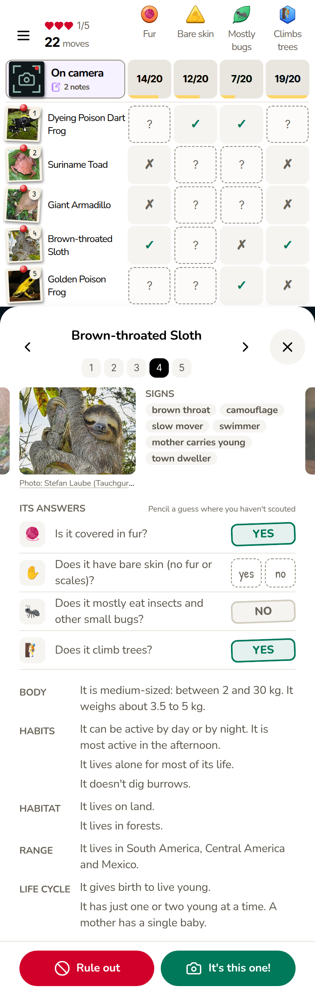
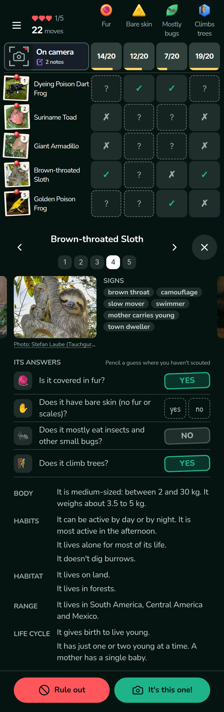
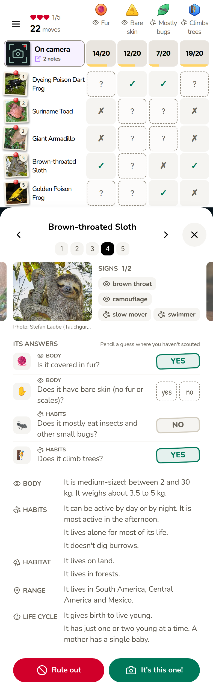
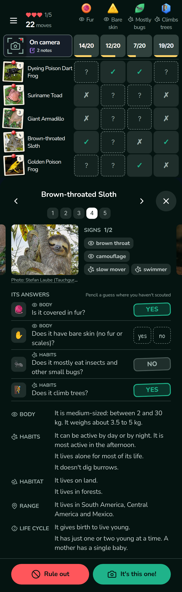
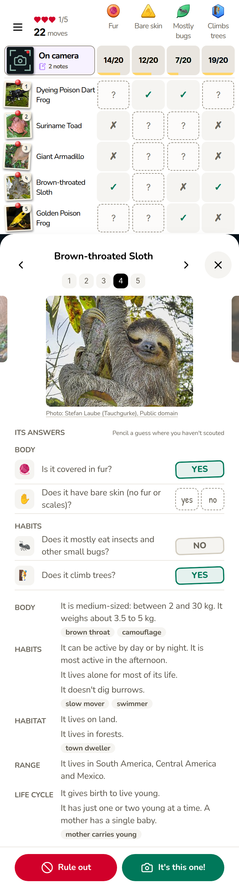
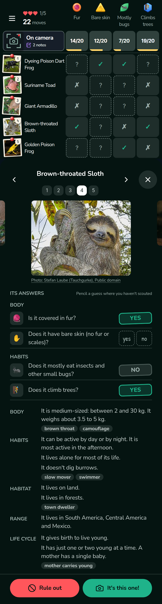
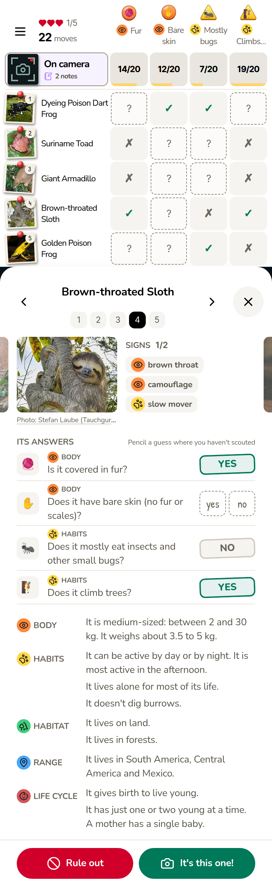
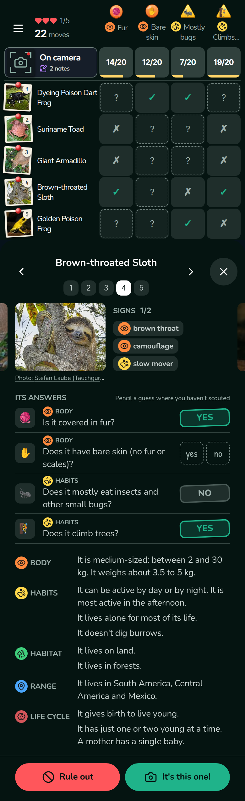

# A movement clue, and signs linked to clue categories (2026-11-07)

Design only (mission `moves-and-signs-design`). Nothing in the game changed. Read on `origin/main` `69f45fa6` (rules `054-1`). The evidence (the per-animal research, the deal and bot runs, the mockup sources) is in `/srv/critter-ai/agent-state/missions/moves-and-signs-design/` on the agents' server, called `STATE` below. The build brief that follows from this doc is [`plans/2026-11-07-moves-and-signs-build-brief.md`](../../plans/2026-11-07-moves-and-signs-build-brief.md).

## 1. Summary

**Movement clue: add one yes/no question, "Does it live in trees?", in Habits, and remove Farms & towns** (option C, section 2). A player can check it from the photo for most animals (8 of its 10 yes-animals are shown in a tree), only 2 animals are hard to call, and only 5 have no record, so it's dealt in 18 of the 149 playable rounds, mostly in Asia. No round is lost. It's narrower than "how it gets around": the broader version (option D, "Climbs trees" and "Digs burrows") was researched and measured too, and is the second pick, but 16 animals are hard to call on it and its most common split rests on a fact no player could see.

**Signs and categories: option 1, category marks** (section 4). One icon per question category on the sign chips, guide headings, "Its answers" rows, question tiles and witness notes; tap a sign to jump to its category in the guide. No new colour. And while a question is dealt, hide the signs and witness notes that would answer it: today about 1 sign in 7 can give a dealt answer away.

**The build** (section 5, and the brief [`plans/2026-11-07-moves-and-signs-build-brief.md`](../../plans/2026-11-07-moves-and-signs-build-brief.md)): about 20–25 mission sessions, then a one-session cleanup after your production content build.

**Your choices, with the mission's pick:**

| Choice | Options | Pick | Why (section) |
|---|---|---|---|
| Movement clue | A several moves in one group · B one main way · **C Lives in trees** · D Climbs trees + Digs burrows | **C** | fairest: 2 hard animals against 16, 5 no-records against 47; dealt as often (18 vs 15 of 149) (§2) |
| Swims | keep · **drop** | **drop** | never dealt: 44 of 76 have no record; where recorded it repeats "Fresh water" 81% of the time (§2) |
| Tree value | **Lives in trees** · Climbs trees | **Lives in trees** | the photo shows it; Climbs trees has 26 no-records and 8 hard animals (§2). Comes with the C pick |
| Pencil weight | **(a) Habits, 3 points** · (b) Body, 1 point · (c) a one-question override | **(a)** | "Body" would be the wrong word on its tile once categories show; extra points on an easy question aren't unfair (§2) |
| Hide answering signs while a question is dealt (changes plan 045's "signs stay") | **yes** · no | **yes** | a sign like `tree_dweller` answers the question outright; costs a median of 1 sign per suspect (§4, rule 1) |
| Skip witness notes that answer a dealt question | **yes** · no | **yes** | the note would hand over the mystery's answer; costs about a third of a note per round, more in North America (§4, rule 2) |
| Link option | **1 category marks** · 2 signs inside the guide · 3 category gem colours | **1** | no new colour, smallest change; 2 lengthens every sheet by 208 px; 3 loses 98 of 149 rounds and fails light-mode contrast (§4) |
| `travelOf` (which way a ruled-out card leaves) | unchanged · read `digs:yes` | **unchanged** under C; `digs:yes` if D | C has no dig trait; under D the bot can't tell the difference and 4 animals leave more truly (§2) |
| Website screenshot refresh | in the build · **later** | **later** | the field-guide shot only lacks the new icons (§5) |

**Already decided by you** (2026-11-07): Farms & towns goes (the clue audit's option A). The build removes it from the 20 content files but keeps its code constants until your production content build, because the deploy goes live before that build; a one-session cleanup removes them afterwards (§5).

**Yours after the build:** the production content build (`npm run content -- build`) from WSL, only after the build's deploy has succeeded; the build mission will ask through the handoff file.

## 2. Movement clue

**Recommendation: option C, one yes/no question "Does it live in trees?", in Habits.** It's the fairest one the research found: a player can check it for most animals from the photo (8 of its 10 yes-animals are shown in a tree), only 2 animals are hard to call, and only 5 have no record. It's dealt about as often as the alternative (18 of the 149 rounds measured, against 15). The second pick is option D, two questions, "Climbs trees" and "Digs burrows": it's closer to "how it gets around", but 16 animals are hard to call on it, 47 animal-values have no record, and its most common split (the two poison frogs) rests on a hard call. "Swims" is dropped under any option: it's never dealt. The numbers are in "Balance" below.

### The options

How answers work on the board (plan 044): a question is dealt only if every suspect in the round has a record for it, and then each suspect answers yes or no. An animal with no record doesn't make the answer "no"; it stops that question from being dealt in any round it's in. So every "no record" makes the question rarer, and a "no" needs a source just as a "yes" does.

| Option | How it's built | Where it breaks | Verdict |
|---|---|---|---|
| **A. Several moves in one question group** (like the habitats: an animal can have several) | One list per animal (`moves`, like `habitats`), with a "none" value for animals with no listed move | Every move must be settled for every animal: one move with no record removes the animal from *every* move question. The sources settle few moves for all 76 | Rejected |
| **B. One main way per animal** (like diet) | One value per animal | Many animals have two: the jaguar climbs and swims, the giant otter swims and digs, sloths climb and swim, pangolins dig and climb. "Main" is almost never stated by a source. This is how today's `travelOf` works, and the clue audit showed it failing | Rejected |
| **C. Just "Lives in trees"** (the clue audit's best single candidate) | One yes/no question | Needs a rule for "lives in" (below). Only 10 animals say yes | **Recommended** |
| **D. One yes/no question per move** (found by this mission) | "Climbs trees", "Digs burrows" (and "Swims" if kept), each its own yes/no question; each move can have its own "no record" | Each move needs a source for each animal; many are silent | Second pick |

C is D with one question. Both use the game's existing trait form (one value per animal, with a note and a source, left out when unknown).

### The values and their rules

The rules were written before any research and not changed after (`STATE/research/rules.md`). Every batch judged by them.

**Kept as candidates:**
- **Lives in trees (C):** yes when it spends most of its active life up in trees: feeds and rests or sleeps there, and comes down rarely. A source must say "arboreal", "lives in trees", "spends most of its time in the canopy" or the like. No when a source says it lives mostly on the ground, underground or in water. An animal that climbs but lives mostly on the ground is a no (with a quote) or no record. It can only be yes if Climbs trees is yes.
- **Climbs trees (D):** yes when it climbs trees, bushes or vines as part of normal wild life: to feed, rest, hunt, nest or escape. Occasional but normal climbing counts (a jaguar resting on a branch). Rocks, cliffs and boulders don't count, nor climbing onto a log to bask, nor zoo stories. No needs a quote that rules climbing out: ground-dwelling with no climbing, fully aquatic, lives underground, a heavy grazer.
- **Digs burrows (D):** yes when it digs its own burrow, tunnel or den to live, sleep, hide or nest in. Burying itself in soil, sand or mud to shelter counts (a frog digging in backwards, a softshell turtle in sand). Digging for food doesn't (the giant anteater tearing open termite mounds), nor scraping a hole only to lay eggs, nor using another animal's burrow. No needs a quote saying how it shelters instead: in trees, in water, under rocks or plants, in borrowed burrows.
- **Swims (strict):** yes when it swims as part of daily life, to feed or travel. Crossing a river now and then, being able to swim if it must, and wallowing don't count. Measured, then dropped (below).

**Dropped before research:**
- **Walks:** nearly every land animal walks, so it tells a player almost nothing.
- **Gallops, crawls:** no rule a content writer can apply the same way twice (a tortoise crawls? a frog?).
- **Hops:** almost the same question as "is it a frog?". Rounds pick relatives first, so a frog round already holds several frogs and Hops rarely splits it.
- **Glides or flies:** only 2 animals (Wallace's flying frog 5, the flying fox 45).

**Merged:** "Lives in trees" is the strict form of "Climbs trees", not a separate move. A game ships one or the other, never both.

### Every source, every animal

All 76 animals were researched on all four values, by these rules, from IUCN and ADW first, then the profile's own sources, then Wikipedia (checking what it cites). Every yes and no has a quote found word for word in a saved copy of the page. Silence is "no record" with a reason; two sources that disagree are both quoted and also "no record" (`STATE/research/moves.csv`, 304 rows; `STATE/research/summary.md`).

| Value | Yes | No | No record | Hard to call |
|---|---|---|---|---|
| Lives in trees | 10 | 61 | 5 | 2 |
| Climbs trees | 18 | 32 | 26 | 8 |
| Digs burrows | 22 | 33 | 21 | 9 |
| Swims | 11 | 21 | 44 | 3 |

"Hard to call" means a careful player would get it wrong from what still shows while the question is dealt: the photo, the field guide's other lines, the signs that stay, and the witness notes (section 3 lists them). The question's own guide line is hidden while it's dealt (plan 045), and so are signs that answer it (section 4).

### How a player can tell

- **Lives in trees:** mostly from the photo. 8 of the 10 yes-animals are shown in a tree (the two tree frogs, the aye-aye, both sloths, the red panda, the tree-kangaroo, the indri), and 44 of the 61 no-animals are shown on the ground or in water. The two hard ones: the Sumatran orangutan (40) is shown sitting in grass and the guide says it lives on land, though grade 6–12 players may well know orangutans are tree apes; the golden snub-nosed monkey's (34) only tree sign, `climber`, is hidden while the question is dealt, and its photo is neutral.
- **Climbs trees:** the photo helps for 8 of the 18 yes-animals, but 5 are shown on the ground (the big-headed turtle 4, the dyeing poison dart frog 9, the orangutan 40, the jaguar 51, the cheetah 58), and the signs that say "climber" are hidden while it's dealt. The surprises (a cheetah that uses trees as lookouts, a poison frog that climbs to carry its tadpoles, the giant panda) are fair to the sources but not to a player.
- **Digs burrows:** never from the photo (all 22 yes-photos are neutral). The signs help where they show digging claws (the pangolins, echidnas, wombat, armadillo, solenodon and aardvark), but the turtles that bury themselves in sand or gravel (2, 4, 18), the Ethiopian wolf (33) and the giant otter (73) have nothing that points at digging, and the giant anteater's (52) digging-claw signs point the wrong way (it digs for food, not burrows).
- **Swims:** the guide's "fresh water" line answers it for most animals already.

### How it fits the engine

The game's code was read for this; each item is a build step (section 5 gives the files).

- **Kind of question:** each value is its own yes/no prefix (`trees:yes` / `trees:no` for C; `climbs:` and `digs:` for D), listed in `EXCLUSIVE_PREFIXES` (`src/clueGame/traits.ts:22`), as one `Sourced` trait per animal, left out when there's no record. Not complete (`COMPLETE_PREFIXES`, `traits.ts:30`): a missing value means "no record", never "no".
- **The "no" must never be asked.** Today every value of a question group becomes a question, and when two values split a round the same way the first in alphabetical order wins. `trees:no` sorts before `trees:yes`, so it would be dealt with its raw tag as text and a ❓ picture. The build adds one rule, named once: a value `no` records an answer but is never asked (about 3 lines in `src/clueGame/questionMatch.ts` and `src/clueGame/animalBoard.ts`). It was tested in every copy: no `:no` was ever dealt, and no ❓ appeared (`STATE/tools/probe.ts`).
- **Category:** Habits, keyed after `social` in `PREFIX_CATEGORY` (`questionMatch.ts:22`). Key order breaks ties between questions that split a round the same way, so a key placed before `system` would win ties against "Fresh water" and "Lives on land". The guide line then goes in the Habits section.
- **Words:** question "Does it live in trees?", short "Lives in trees?", column "Lives in trees"; guide lines "It lives in trees." and "It doesn't live in trees." (a no must read as a sentence, unlike a missing habitat line). For D: "Does it climb trees?" / "Climbs trees" / "It climbs trees.", and "Does it dig burrows?" / "Digs burrows" / "It digs burrows.". These were the drafts in the test copies; the build may polish them.
- **Gem picture:** one unique, non-animal face per new question (`src/clueGame/clueFaces.ts`). The drafts used 🌲 (trees), 🧗 (climbs), ⛏️ (digs). A missing face shows ❓, and two ❓ questions can never share a round, silently, so each needs its own.
- **Field guide:** the trait's lines come from `src/clueGame/profiles.ts` (the `traits` type, the yes/no lines, `TRAIT_VALUES`), as for the existing traits.
- **Overlap with today's questions:** Swims repeats "Fresh water" for 26 of the 32 animals that have a Swims record (81%; below). "Lives in trees" overlaps nothing asked today; the open sign `tree_dweller` says the same thing, so it's hidden while the question is dealt (section 4).
- **`travelOf`** (which way a ruled-out card walks off the board, `animalBoard.ts:199`): under C, unchanged, because there's no dig or climb trait to read. Under D, it should read `digs:yes` instead of the open tag `burrower`: the bot can't tell the difference (within ±1 point and ±0.2 moves everywhere), it changes only 4 animals (2, 4, 18, 33 now leave downward, as diggers), and the walk-off then agrees with the Digs answer.
- **Pencil weight** (plan 054 pays per category: Body 1, Habitat 2, Habits 3; `animalBoard.ts:433`). An owner's choice, because a question checkable from the photo pays 3 in Habits:
  - (a) keep it in Habits at weight 3. **The mission's pick.** Even though 8 of the 10 yes-photos show a tree, "Body" would be the wrong word on its tile once the category is shown (section 4), and the extra points on an easy question are generous, not unfair.
  - (b) put it in Body at weight 1, which fits 054's "seen in the photo"; its guide line moves to Body.
  - (c) a per-question weight override in `PENCIL_WEIGHT`, one line, but it breaks 054's one weight per category.

### Balance

Measured on throwaway copies of the game with Farms & towns removed (the owner's decision, 2026-11-07) and the researched values added, nothing else changed. Every playable round was dealt as the game deals it: the world and each continent with 12 or more animals, each animal as a seed, the suspect set picked and then the four clues dealt (`STATE/deals/metrics.md`, per variant `STATE/deals/<variant>.md`). The C and D copies also had section 4's sign rules on, since they change what the bot reads; the baseline copy didn't. Then the game's balance bot played 400 rounds per continent (`STATE/bot/summary.md`).

| | No Farms & towns (baseline) | C: Lives in trees | D: Climbs + Digs | D + Swims |
|---|---|---|---|---|
| Rounds that can be dealt (world / Africa / Asia / N. America / S. America) | 76 / 26 / 20 / 13 / 14 | same | same | same |
| Rounds dealing the new clue, of 149 | — | **18** (7 / 0 / 8 / 2 / 1) | **15** (5 / 1 / 6 / 0 / 3); Climbs 11, Digs 4 | 15; Swims 0 |
| Share of world rounds | — | 9.2% | 6.6% | 6.6% |
| Rounds where the new clue can be asked at all (all 5 suspects have a record), world | — | 13 | Climbs 4, Digs 11 | Swims 0 |
| Rounds where one suspect's "no record" blocks it, world | — | 21 | Climbs 53, Digs 47 | Swims 70 |
| Pairs of suspects only the new clue tells apart in the dealt clues (world / Asia / N. Am. / S. Am.) | — | 16 (7 / 8 / 1 / 0) | 12 (5 / 4 / 0 / 3) | 12 |
| Different suspect sets, world | 52 | 47 | 52 | 52 |
| Rounds lost | — | 0 | 0 | 0 |
| Bot, careful player: moves left when found, change (Africa / Asia / N. Am. / S. Am.) | 16.9 / 14.3 / 16.9 / 17.0 | −0.7 / −0.6 / −3.9 / −1.1 | −0.6 / +0.4 / −2.7 / −1.5 | not run |
| Bot, find rate | 97–99% | within noise | within noise | not run |

What the numbers say:
- **No option loses a round.** Both clues mostly *add* new suspect sets rather than split old ones: look-alikes the game couldn't put together before, because nothing told them apart.
- **Those new sets hinge on one animal each.** Under C, 7 of the 8 Asian rounds dealing it pair the saola (38) with the Sumatran orangutan (40), and "Lives in trees" is the only dealt clue that tells them apart; the orangutan is one of C's 2 hard animals, but "orangutans live in trees" is common knowledge. Under D, 5 rounds (world 2, South America 3) pair the two poison frogs (9 and 76), and only "Climbs trees" tells them apart: that rests on the dyeing poison dart frog climbing to carry its tadpoles, which nothing in the game shows and few players would know. Of D's other 7, 4 are the same saola–orangutan pair and 3 hinge on the giant otter (73) digging burrows, also a hard call. This is the main reason C wins on fairness.
- **"No record" is the cost of D.** Climbs trees can be asked in only 4 world sets, because one suspect without a record blocks it in 53. C's 5 no-records block 21.
- **Swims is never dealt.** 44 of 76 animals have no record, so no round has all 5 suspects holding one. Where it is recorded, it repeats "Fresh water" for 81%. Dropped.
- **The bot's moves left** fall slightly in every option, by about the same amount; find rates don't move beyond noise (the noise is ±1 point for the careful player, ±4 for the reader, from two runs of the baseline). The big drop in North America (−3.9 / −2.7) isn't the movement clue: D deals it 0 times there. It's section 4's rule that hides a witness note whose tag answers a dealt question; North America's notes often do, so its notes fall from about 1.1 to 0.5 a round (C 1.09 → 0.45, D 1.18 → 0.51). Section 4 weighs that against the leak it stops.
- **Knowing it on sight** (the bot told the answer, as a player reading the photo would be) adds at most 0.6 moves: the clue is too rarely dealt to matter much.
- **Rarity:** either clue is in about 1 round in 8 to 10 (C 18 / D 15 of 149), concentrated in Asia (C 40%, D 30% of its rounds). C is never dealt in Africa (its 2 askable sets lose to earlier questions), D never in North America.
- **D + Swims and C + Digs:** D + Swims changes nothing (Swims is never dealt). "Lives in trees" plus "Digs burrows" wasn't measured; it would bring back Digs's 9 hard animals.

### Recommendation

**Ship C, "Does it live in trees?", in Habits at pencil weight 3, with Farms & towns removed.** It meets the brief's first decision rule best: a player can check it from the photo for most animals, it has 2 hard animals against D's 16, its 5 no-records keep it askable, and it's the smaller build (one question, one face, no `travelOf` change). It's dealt slightly more often than D. What the owner gives up is breadth: it's one tree question, not "how it gets around", and digging and swimming aren't asked.

If the owner wants the broader clue, ship D (Climbs trees + Digs burrows), with `travelOf` reading `digs:yes`, and accept the 16 hard animals and the poison-frog rounds. Either way, drop Swims. All values for both options are in section 3, so the build needs no new research.

## 3. The 76 animals

One row per animal, from `STATE/research/moves.csv` (written by `STATE/tools/table.py`; Swims is left out, since it's dropped). Each cell gives the value, then the quote and its source for a yes or no, or the reason for a no record. ⚠ **hard** marks the ones a careful player would get wrong from what still shows while that question is dealt. The last column says what still shows, per question the animal has a record for: the photo, the field guide's other lines (verbatim), and the signs that stay. Questions with no record are never dealt for that animal, so they have no entry there.

"Lives in trees" is the recommended option (C). "Climbs trees" and "Digs burrows" are option D, kept here so the build has them if the owner picks D.

| # | Animal | Lives in trees (C, recommended) | Climbs trees (D) | Digs burrows (D) | How a player can tell |
|---|---|---|---|---|---|
| 1 | Blanding's Turtle | **no**: "Blanding’s turtles are semi-aquatic, living mostly in shallow wetland habitats where aquatic vegetation is abundant." ([ADW](https://animaldiversity.org/accounts/Emydoidea_blandingii/)) | **no record**: IUCN, ADW and Wikipedia silent on tree climbing; resting on logs out of the water is basking, which does not count; mostly aquatic is not fully aquatic, so nothing rules climbing out. | **no record**: Only digging recorded is the 12 cm egg hole (ADW), which is nesting. ADW says it overwinters in ponds; Wikipedia (uncited sentence) says in mud or under vegetation or debris, which neither says it digs in nor rules it out. IUCN silent. | *Trees:* photo points to no; guide "It lives on land and in fresh water." / "It lives in wetlands: rivers, lakes, marshes or swamps."; signs `shallow_wetlands`. |
| 2 | Spiny Softshell Turtle | **no**: "If disturbed, they will quickly retreat into the water and bury themselves in sand, leaving only their heads visible." ([ADW](https://animaldiversity.org/accounts/Apalone_spinifera/)) | **no record**: IUCN and ADW silent on climbing; basking on logs and branches out of the water (IUCN) does not count; not fully aquatic (basks on sandbars), so nothing rules climbing out. | **yes**: "If disturbed, they will quickly retreat into the water and bury themselves in sand, leaving only their heads visible." ([ADW](https://animaldiversity.org/accounts/Apalone_spinifera/)) ⚠ **hard** | *Trees:* guide "It lives on land and in fresh water." / "It lives in wetlands: rivers, lakes, marshes or swamps."; signs `sandy_bottoms`, `underwater_breathing`. *Digs:* signs `winter_rest`, `sandy_bottoms`. **Hard:** both burying notes answer digs (buries_itself, one added by rule 5) and hide; only the sandy-bottoms and winter-rest hints show, and neither says it digs. |
| 3 | Darwin Frog | **no**: "This species generally occurs in the leaf-litter of temperate Nothofagus forests; it is also present in forest bogs." ([IUCN](https://www.iucnredlist.org/species/19513/79809372)) | **no record**: IUCN (leaf-litter, forest bogs), ADW (temperate forests and rainforests) and Wikipedia silent on climbing; leaf-litter life does not rule climbing out; AmphibiaWeb cache is an error page. | **no record**: IUCN, ADW and Wikipedia silent on burrows or how it shelters; eggs laid on moist soil/moss is not a burrow. | *Trees:* photo points to no; signs `leaf_litter`. |
| 4 | Big-headed Turtle | **no**: "Turtles spend the day underwater, burrowed into gravel deposits or hidden in crevices in the rocks." ([paper](https://web.archive.org/web/20110522230829/http://www.unc.edu/~dtkirkpa/stuff/bigheads.html)) | **yes**: "Given all these adaptations, it is not surprising that Big-headed turtles have been reported to climb trees and bushes." ([paper](https://web.archive.org/web/20110522230829/http://www.unc.edu/~dtkirkpa/stuff/bigheads.html)) ⚠ **hard** | **yes**: "Turtles spend the day underwater, burrowed into gravel deposits or hidden in crevices in the rocks." ([paper](https://web.archive.org/web/20110522230829/http://www.unc.edu/~dtkirkpa/stuff/bigheads.html)) ⚠ **hard** | *Trees:* photo points to no; guide "It is active at night. By day it hides under rocks or underwater."; signs `cold_streams`. *Climbs:* photo points to no; guide "It is active at night. By day it hides under rocks or underwater."; signs `cold_streams`, `long_tail`. **Hard:** photo shows it on wet stream rocks and the guide says it hides under rocks or underwater by day; the climber sign is hidden, so nothing showing points at trees. *Digs:* guide "It is active at night. By day it hides under rocks or underwater."; signs `cold_streams`. **Hard:** the guide still says it hides under rocks or underwater by day, which reads as no burrow, and no sign points at digging. |
| 5 | Wallace's Flying Frog | **yes**: "Wallace's flying frog spends its time in the trees where it can glide in the air" ([ADW](https://animaldiversity.org/accounts/Rhacophorus_nigropalmatus/)) | **yes**: "Wallace's flying frog is an arboreal amphibian that has a terminal segment of each finger and toe which is expanded into specialized toepads that allow these treefrogs to adhere to vertical surfaces." ([ADW](https://animaldiversity.org/accounts/Rhacophorus_nigropalmatus/)) | **no**: "Wallace's flying frog spends its time in the trees where it can glide in the air" ([ADW](https://animaldiversity.org/accounts/Rhacophorus_nigropalmatus/)) | *Trees:* photo shows yes. *Climbs:* photo shows yes. *Digs:* photo points to no; signs `glider`, `tree_dweller`. |
| 6 | Red-eyed Tree Frog | **yes**: "Adults live in the canopy layer of the rainforest, sometimes hiding inside bromeliads." ([NGO](https://www.rainforest-alliance.org/species/red-eyed-tree-frog/)) | **yes**: "Adept climbers, red-eyed tree frogs have cup-like footpads that enable them to spend their days clinging to leaves in the rainforest canopy" ([NGO](https://www.rainforest-alliance.org/species/red-eyed-tree-frog/)) | **no**: "In response to high heat or dry seasons, red-eyed tree frogs find shelter under broad leaves closer to the forest floor." ([ADW](https://animaldiversity.org/accounts/Agalychnis_callidryas/)) | *Trees:* photo shows yes. *Climbs:* photo shows yes. *Digs:* photo points to no; signs `tree_dweller`. |
| 7 | Hairy Frog | **no**: "It lives in fast-flowing rivers in lowland and mid-altitude rainforest, and in secondary forest and agricultural habitats, including tea plantations." ([IUCN](https://www.iucnredlist.org/species/54443/18361006)) | **no record**: IUCN and Wikipedia silent on climbing; no ADW account; AmphibiaWeb blocked; nothing rules climbing out. | **no record**: IUCN and Wikipedia silent on burrows or shelter; no ADW account; AmphibiaWeb blocked. | *Trees:* signs `fast_streams`. |
| 8 | Coastal Tailed Frog | **no**: "During dry weather it stays on moist stream-banks and lays eggs in long strings under stones in water." ([IUCN](https://www.iucnredlist.org/species/54414/196332997)) | **no record**: IUCN, ADW and COSEWIC silent on climbing; streamside life does not rule it out; cliff crevices (Wikipedia genus page) are rocks and do not count. | **no**: "Often hidden under rocks in streams during hot days" ([government](https://www.canada.ca/en/environment-climate-change/services/species-risk-public-registry/cosewic-assessments-status-reports/coastal-tailed-frog-ascaphus-truei-2011.html)) | *Trees:* signs `cold_streams`. *Digs:* nothing shown points either way. |
| 9 | Dyeing Poison Dart Frog | **no**: "It inhabits the forest floor in lowland tropical rainforest." ([IUCN](https://www.iucnredlist.org/species/55204/61395760)) | **yes**: "particularly beneficial during tadpole transport…a task that requires long displacements and prolonged exposure…especially when climbing trees…We observed tadpole deposition in different water-holding structures in the forest, from palm bracts on the ground to tree holes high up." ([paper](https://peerj.com/articles/7648/)) ⚠ **hard** | **no record**: IUCN, ADW (D. azureus account) and Rojas & Pašukonis 2019 never say it digs; hiding around logs/roots is not clearly a shelter description, and eggs laid in animal burrows are borrowed burrows. | *Trees:* photo points to no; guide "It lives alone for most of its life. Males and females each defend their own patch of ground.". *Climbs:* photo points to no; guide "It lives alone for most of its life. Males and females each defend their own patch of ground.". **Hard:** photo shows it on ground moss and the guide says it defends a patch of ground; climbing only happens on tadpole trips. |
| 10 | Suriname Toad | **no**: "They lie on the bottom, returning to the surface for air generally every half hour. They do not leave the water voluntarily." ([ADW](https://animaldiversity.org/accounts/Pipa_pipa/)) | **no**: "They lie on the bottom, returning to the surface for air generally every half hour. They do not leave the water voluntarily." ([ADW](https://animaldiversity.org/accounts/Pipa_pipa/)) | **no**: "This is an aquatic species that lives in slow flowing watercourses, backwater of streams, and ponds and pools in tropical rainforest, hiding under submerged leaf-litter." ([IUCN](https://www.iucnredlist.org/species/58163/85900348)) | *Trees:* nothing shown points either way. *Climbs:* nothing shown points either way. *Digs:* signs `fully_aquatic`. |
| 11 | Goliath Frog | **no**: "Younger frogs spend most of their time underwater whereas older frogs occasionally bask on rocks." ([ADW](https://animaldiversity.org/accounts/Conraua_goliath/)) | **no record**: IUCN, ADW and Wikipedia silent on climbing; river/rock life does not rule it out. | **no record**: Only digging recorded is nest pools for eggs (Wikipedia citing Schäfer et al. 2019, J. Nat. Hist., not fetched): nesting does not count. IUCN and ADW silent on any shelter burrow. | *Trees:* signs `fast_streams`, `rock_basker`. |
| 12 | Spiny Hill Turtle | **no**: "Adults are terrestrial in habits, while juvenile are more amphibious." ([government](https://www.nparks.gov.sg/florafaunaweb/fauna/0/6/06)) | **no record**: IUCN, NParks, Ecology Asia and Wikipedia silent on climbing; forest-floor life does not rule climbing out. No ADW account (classification page only). | **no**: "The spiny turtle buries itself in leaf litter to camouflage during the day and only emerges at night, foraging for food." ([Wikipedia](https://en.wikipedia.org/wiki/Spiny_turtle)) | *Trees:* signs `leaf_litter`. *Digs:* signs `leaf_litter`, `camouflage`. |
| 13 | Madagascar Tomato Frog | **no record**: climbs_trees is no-record; no quote that it lives in trees or mostly on the ground (IUCN, ADW, Wikipedia silent). | **no record**: IUCN Habitat and Ecology and ADW account silent on climbing (ADW key behaviour saltatorial only); Wikipedia species page silent; Smithsonian page is D. guineti (wrong species). | **yes**: "These areas include both rainforest and wooded coastal areas, underbrush both wet and dry, and urban areas of varying levels of disturbance as long as there is somewhere to burrow." ([ADW](https://animaldiversity.org/accounts/Dyscophus_antongilii/)) ⚠ **hard** | *Digs:* nothing shown points either way. **Hard:** nothing still showing points at digging (burrower sign hidden); photo shows it sitting on grass and the guide shows wetlands, farms and towns. |
| 14 | Desert Rain Frog | **no**: "This is a fossorial species that digs burrows into coastal sand dunes that are vegetated with low, succulent shrubs and other xerophytic vegetation." ([IUCN](https://www.iucnredlist.org/species/3070/248906550)) | **no**: "This is a fossorial species that digs burrows into coastal sand dunes that are vegetated with low, succulent shrubs and other xerophytic vegetation." ([IUCN](https://www.iucnredlist.org/species/3070/248906550)) | **yes**: "This is a fossorial species that digs burrows into coastal sand dunes that are vegetated with low, succulent shrubs and other xerophytic vegetation." ([IUCN](https://www.iucnredlist.org/species/3070/248906550)) | *Trees:* guide "It lives on land.". *Climbs:* guide "It lives on land." / "It lives in shrubland, land covered in bushes.". *Digs:* guide "It lives in desert." / "It is active at night. It is most active on foggy nights."; signs `eggs_on_land`, `coastal_dunes`. |
| 15 | Pancake Tortoise | **no**: "Individual Pancake Tortoises are usually found in fissures and crevices in and between boulders and bedrock." ([IUCN](https://www.iucnredlist.org/species/12696/508210)) | **no record**: Climbs boulders and rock faces only, which does not count (rules.md edge case 1); IUCN and TFTSG silent on trees or bushes and nothing rules tree climbing out. No ADW account (classification page only). | **no**: "where it hides in crevices between and under exfoliating slabs of pre-Cambrian rock (gneiss)" ([IUCN](https://www.iucnredlist.org/species/12696/508210)) | *Trees:* photo points to no; guide "It lives in rocky places like cliffs, boulder hills or mountain peaks."; signs `kopjes`, `crevice_hider`. *Digs:* guide "It lives in rocky places like cliffs, boulder hills or mountain peaks."; signs `crevice_hider`, `kopjes`. |
| 16 | Purple Frog | **no**: "For most of the year it is a fossorial species, living from 1.3–3.7m below ground" ([IUCN](https://www.iucnredlist.org/species/58051/166098621)) | **no**: "For most of the year it is a fossorial species, living from 1.3–3.7m below ground" ([IUCN](https://www.iucnredlist.org/species/58051/166098621)) | **yes**: "metamorphs dig directly into the soil and lead a secretive life underground … Adults are among the largest digging frogs" ([paper](https://doi.org/10.1371/journal.pone.0151114)) | *Trees:* guide "It lives in forests.". *Climbs:* guide "It lives in forests.". *Digs:* guide "It eats insects and other small invertebrates. Mostly termites, which it catches underground."; signs `pointed_snout`. |
| 17 | Pig-nosed Turtle | **no**: "Males never come out of the water and females only come out when they are about to lay eggs." ([ADW](https://animaldiversity.org/accounts/Carettochelys_insculpta/)) | **no**: "Males never come out of the water and females only come out when they are about to lay eggs." ([ADW](https://animaldiversity.org/accounts/Carettochelys_insculpta/)) | **no**: "Males never come out of the water and females only come out when they are about to lay eggs." ([ADW](https://animaldiversity.org/accounts/Carettochelys_insculpta/)) | *Trees:* photo points to no; signs `flippers`, `brackish_water`. *Climbs:* photo points to no; signs `flippers`. *Digs:* signs `fully_aquatic`, `flippers`. |
| 18 | Yangtze Giant Softshell Turtle | **no**: "describes it as cryptic, fairly sedentary, inhabiting sluggish or still waters associated with major rivers, shuffled into the mud and detritus on the bottom" ([IUCN](https://www.iucnredlist.org/species/39621/2931537)) | **no**: "describes it as cryptic, fairly sedentary, inhabiting sluggish or still waters associated with major rivers, shuffled into the mud and detritus on the bottom" ([IUCN](https://www.iucnredlist.org/species/39621/2931537)) | **yes**: "describes it as cryptic, fairly sedentary, inhabiting sluggish or still waters associated with major rivers, shuffled into the mud and detritus on the bottom" ([IUCN](https://www.iucnredlist.org/species/39621/2931537)) ⚠ **hard** | *Trees:* signs `big_rivers`, `giant_turtle`. *Climbs:* signs `big_rivers`, `giant_turtle`. *Digs:* nothing shown points either way. **Hard:** the buries_itself sign is hidden and nothing else showing points at digging; a giant river turtle reads as a swimmer, not a digger. |
| 19 | Floreana Giant Tortoise | **no**: "Chelonoidis niger was a diurnal and terrestrial tortoise…During the rainy season, adults of C. niger descended to the grass covered lowlands to feed." ([paper](https://www.reptilesofecuador.com/chelonoidis_niger.html)) | **no record**: IUCN: no specific ecology known; Reptiles of Ecuador (Arteaga et al. 2020, cited by Wikipedia) and Wikipedia: terrestrial grazer on grass, bitterbush and cacti; none mentions climbing or its body mass, and terrestrial alone does not rule it out. Extinct; no photo. | **no record**: IUCN (no specific ecology), Reptiles of Ecuador, Galapagos Conservancy and Wikipedia silent on burrows or shelter. No photo. | *Trees:* nothing shown points either way. |
| 20 | African Spurred Tortoise | **no**: "The species makes extensive use of deep and long burrows (up to 15 m long), occasionally used by more than one individual, and above-ground activity is mainly concentrated in the early morning hours and during the wet season (August)." ([IUCN](https://www.iucnredlist.org/species/163423/1006958)) | **no**: "Males are larger than females, and may exceed 100 kg in body mass…The species is mostly herbivorous" ([IUCN](https://www.iucnredlist.org/species/163423/1006958)) | **yes**: "this tortoise digs dens up to 10 feet (3 meters) deep to recline in during the heat of the day" ([SDZWA](https://animals.sandiegozoo.org/animals/african-spurred-tortoise)) ⚠ **hard** | *Trees:* photo points to no; guide "It is active during the day. It is out mostly in the early morning and in the rainy season.". *Climbs:* photo points to no. *Digs:* guide "It is active during the day. It is out mostly in the early morning and in the rainy season.". **Hard:** the burrower sign is hidden; the photo shows it walking on grass and nothing else showing points at digging. |
| 21 | Radiated Tortoise | **no**: "They are known to graze regularly in the same area, thus keeping the vegetation in that area closely trimmed." ([ADW](https://animaldiversity.org/accounts/Astrochelys_radiata/)) | **no record**: IUCN, ADW and Wikipedia silent on climbing; a medium (up to 16 kg) grazing tortoise, not clearly heavy-bodied, so nothing rules climbing out. | **no record**: IUCN, ADW and Wikipedia silent on burrows or shelter; the guide's egg hole is nesting and does not count. | *Trees:* photo points to no; signs `grazer`. |
| 22 | Pinta Island Tortoise | **no**: "Chelonoidis abingdonii was a diurnal and terrestrial tortoise…Wild Pinta Giant-Tortoises fed on low-hanging cactus pads." ([paper](https://www.reptilesofecuador.com/chelonoidis_abingdonii.html)) | **no record**: IUCN, Reptiles of Ecuador and Wikipedia: terrestrial browser of low-hanging cactus pads; none mentions climbing or this species' body mass, and terrestrial alone does not rule it out. | **no record**: IUCN, Reptiles of Ecuador, Galapagos Conservation Trust and Wikipedia silent on burrows or shelter. | *Trees:* photo points to no. |
| 23 | Aye-aye | **yes**: "They spend most of their time in the upper two levels of the canopy." ([ADW](https://animaldiversity.org/accounts/Daubentonia_madagascariensis/)) | **yes**: "Aye-ayes are able to make use of a wide range of locomotor methods including arboreal quadrupedalism, leaping, and head-first descent." ([ADW](https://animaldiversity.org/accounts/Daubentonia_madagascariensis/)) | **no**: "Most of the daytime is spent sleeping in an ovular nest located in the upper two levels of the canopy." ([ADW](https://animaldiversity.org/accounts/Daubentonia_madagascariensis/)) | *Trees:* photo shows yes. *Climbs:* photo shows yes. *Digs:* photo points to no; signs `tree_dweller`, `hangs_upside_down`. |
| 24 | Sunda Pangolin | **no record** (sources disagree): "Although they are terrestrial creatures that inhabit burrows, either excavated with their huge claws or borrowed from previous residents, they are known to be agile climbers and spend time within trees resting or searching for food." ([ADW](https://animaldiversity.org/accounts/Manis_javanica/)) vs "It is largely arboreal." ([source 2](https://en.wikipedia.org/wiki/Sunda_pangolin)) | **yes**: "They are adept climbers and their prehensile tails make excellent climbing aids. They often climb to access ants nests, including weaver ants, in trees (Lim 2007)." ([IUCN](https://www.iucnredlist.org/species/12763/123584856)) | **yes**: "They sleep in hollows either in, or at the base of, trees, but have also been known to dig burrows in soil and shelter in fallen logs." ([IUCN](https://www.iucnredlist.org/species/12763/123584856)) | *Climbs:* guide "It lives in forests." / "It lives in shrubland, land covered in bushes."; signs `long_tail`. *Digs:* signs `digging_claws`. |
| 25 | Tiger | **no**: "They are the largest terrestrial mammal whose diet consists entirely of meat" ([Smithsonian](https://nationalzoo.si.edu/animals/tiger)) | **no record**: ADW "excellent climbers" states ability and names no trees; SDZWA only "Tigers can carry something twice their own body weight 10 feet (3 meters) up a tree" (ability); Wikipedia (citing Mazák 1981 and Thapar 2004, books, not fetchable): adults less able to climb than other cats, cubs may routinely, one adult recorded 10 m up a pipal tree (anecdote). No source ties adult tree climbing to daily life; nothing rules it out. IUCN and Smithsonian silent. | **no**: "Within their home range tigers maintain several dens, often among dense vegetation or in a cave, cavity under a fallen tree, or in a hollow tree." ([ADW](https://animaldiversity.org/accounts/Panthera_tigris/)) | *Trees:* photo points to no. *Digs:* nothing shown points either way. |
| 26 | Black-footed Ferret | **no**: "They spend most of their time underground in prairie dog burrows, typically spending only a few minutes above ground each day during the first few hours following sunrise to hunt or find new burrows or mates." ([Smithsonian](https://nationalzoo.si.edu/animals/black-footed-ferret)) | **no**: "Black-footed ferrets are subterranean animals that utilize prairie dog burrows for travel and shelter." ([ADW](https://animaldiversity.org/accounts/Mustela_nigripes/)) | **no**: "They live within the abandoned burrows of prairie dogs and use these complex underground tunnels for shelter and hunting." ([ADW](https://animaldiversity.org/accounts/Mustela_nigripes/)) | *Trees:* photo points to no. *Climbs:* guide "It lives in grassland." / "It lives in shrubland, land covered in bushes.". *Digs:* signs `prairie_dog_towns`. |
| 27 | Western Long-beaked Echidna | **no**: "Long-beaked echidnas are terrestrial and live in tropical forest environments, inhabiting the humid underbrush." ([ADW](https://animaldiversity.org/accounts/Zaglossus_bruijni/)) | **no record**: ADW: terrestrial, forages in leaf litter of the forest floor; IUCN: nothing is known about this species in particular; Wikipedia silent. Terrestrial / forest floor alone does not rule climbing out (precedent 12, 65, 72). | **yes**: "Western long-beaked echidnas are deliberate and slow foragers…They excavate burrows efficiently, providing shelter from predators and extreme weather conditions." ([ADW](https://animaldiversity.org/accounts/Zaglossus_bruijni/)) | *Trees:* photo points to no; guide "It lives in forests."; signs `burrower`. *Digs:* signs `digging_claws`. |
| 28 | Asian Elephant | **no**: "Elephas maximus is a nomadic species that lives on the ground and moves around frequently." ([ADW](https://animaldiversity.org/accounts/Elephas_maximus/)) | **no**: "Elephas maximus is a nomadic species that lives on the ground and moves around frequently." ([ADW](https://animaldiversity.org/accounts/Elephas_maximus/)) | **no**: "Resting position Adults rest while standing (McKay 1973)" ([SDZWA](https://ielc.libguides.com/sdzg/factsheets/asianelephant/behavior)) | *Trees:* photo points to no; guide "It is huge: over 300 kg. Males weigh 3,500 to 6,000 kg." / "It lives on land.". *Climbs:* photo points to no; guide "It is huge: over 300 kg. Males weigh 3,500 to 6,000 kg." / "It lives on land.". *Digs:* nothing shown points either way. |
| 29 | Okapi | **no**: "Okapis are terrestrial animals whose territorial range can stretch anywhere from 450 to 1,500 m. They mainly reside in lush, high canopy rainforests where they eat understory foliage." ([ADW](https://animaldiversity.org/accounts/Okapia_johnstoni/)) | **no**: "Okapis are terrestrial animals whose territorial range can stretch anywhere from 450 to 1,500 m. They mainly reside in lush, high canopy rainforests where they eat understory foliage." ([ADW](https://animaldiversity.org/accounts/Okapia_johnstoni/)) | **no record**: IUCN, ADW, SDZWA (page and fact sheet: "30-50% of the day spent resting", calves at "the nest") and Wikipedia never say where adults rest or shelter, nor that it digs; the calf hiding spot is not described. Silence on burrows/shelter. | *Trees:* photo points to no; guide "It lives on land."; signs `hooves`. *Climbs:* photo points to no; guide "It is large: between 30 and 300 kg. It weighs about 290 kg on average." / "It lives on land."; signs `hooves`. |
| 30 | Pygmy Three-toed Sloth | **yes**: "Pygmy three-toed sloths are mainly arboreal, although they can walk on the ground and also swim." ([ADW](https://animaldiversity.org/accounts/Bradypus_pygmaeus/)) | **yes**: "Pygmy three-toed sloths are mainly arboreal, although they can walk on the ground and also swim." ([ADW](https://animaldiversity.org/accounts/Bradypus_pygmaeus/)) | **no**: "Pygmy three-toed sloths are arboreal folivores." ([ADW](https://animaldiversity.org/accounts/Bradypus_pygmaeus/)) | *Trees:* photo shows yes. *Climbs:* photo shows yes. *Digs:* photo points to no; signs `tree_dweller`, `hangs_upside_down`. |
| 31 | Northern Hairy-nosed Wombat | **no**: "Nocturnal and solitary, Northern Hairy-nosed Wombats can live to at least 30 years, spending most of their time underground and emerging at night to feed on grasses and sedges." ([NGO](https://www.australianwildlife.org/animals/northern-hairy-nosed-wombat)) | **no**: "Nocturnal and solitary, Northern Hairy-nosed Wombats can live to at least 30 years, spending most of their time underground and emerging at night to feed on grasses and sedges." ([NGO](https://www.australianwildlife.org/animals/northern-hairy-nosed-wombat)) | **yes**: "they construct very large and intricate tunnel systems (called warrens) in deep sand." ([ADW](https://animaldiversity.org/accounts/Lasiorhinus_krefftii/)) | *Trees:* photo points to no; guide "It lives on land." / "It lives in savanna: grassland with scattered trees."; signs `burrower`, `digging_claws`, `grazer`. *Climbs:* photo points to no; guide "It lives in savanna: grassland with scattered trees."; signs `burrower`, `digging_claws`, `grazer`. *Digs:* signs `digging_claws`, `backward_pouch`. |
| 32 | De Winton's Golden Mole | **no**: "Golden moles are elusive little animals that spend nearly their entire lives underground. … For the sand-dwelling species, such as De Winton’s golden mole ( Cryptochloris wintoni ), even these ridges are hard to find, since the subsurface tunnels collapse in the soft sand." ([news](https://theconversation.com/golden-mole-that-swims-through-sand-is-rediscovered-in-south-africa-after-86-years-219022)) | **no**: "Golden moles are elusive little animals that spend nearly their entire lives underground. … For the sand-dwelling species, such as De Winton’s golden mole ( Cryptochloris wintoni ), even these ridges are hard to find, since the subsurface tunnels collapse in the soft sand." ([news](https://theconversation.com/golden-mole-that-swims-through-sand-is-rediscovered-in-south-africa-after-86-years-219022)) | **yes**: "For the sand-dwelling species, such as De Winton’s golden mole ( Cryptochloris wintoni ), even these ridges are hard to find, since the subsurface tunnels collapse in the soft sand." ([news](https://theconversation.com/golden-mole-that-swims-through-sand-is-rediscovered-in-south-africa-after-86-years-219022)) | *Trees:* photo points to no; signs `burrower`, `sand_swimmer`. *Climbs:* guide "It lives in shrubland, land covered in bushes."; signs `burrower`, `sand_swimmer`. *Digs:* guide "Its family is Chrysochloridae, the golden moles."; signs `poor_eyesight`, `senses_vibrations`. |
| 33 | Ethiopian Wolf | **no**: "Wolves utilize all Afroalpine habitats, but prefer open areas with short herbaceous and grassland communities where rodents are most abundant" ([IUCN](https://www.iucnredlist.org/species/3748/10051312)) | **no**: "Endemic to the Ethiopian highlands, above the tree line at about 3,200 m." ([IUCN](https://www.iucnredlist.org/species/3748/10051312)) | **yes**: "The female gives birth to her litter in a den she digs in open ground under a boulder or in a rocky crevice." ([ADW](https://animaldiversity.org/accounts/Canis_simensis/)) ⚠ **hard** | *Trees:* photo points to no; signs `high_mountains`. *Climbs:* photo points to no; signs `high_mountains`. *Digs:* guide "It is active during the day. At night it sleeps out in the open.". **Hard:** the guide still says it sleeps out in the open at night, which reads as no den, and no sign points at digging (the rodent hunter note is about food). |
| 34 | Golden Snub-nosed Monkey | **yes**: "Pygathrix roxellana is a largely arboreal species." ([ADW](https://animaldiversity.org/accounts/Rhinopithecus_roxellana/)) ⚠ **hard** | **yes**: "Although the species feeds largely from arboreal sources, it will descend to the ground to feed on grasses and wild onions." ([ADW](https://animaldiversity.org/accounts/Rhinopithecus_roxellana/)) | **no**: "Pygathrix roxellana is a largely arboreal species." ([ADW](https://animaldiversity.org/accounts/Rhinopithecus_roxellana/)) | *Trees:* nothing shown points either way. **Hard:** under C the climber sign answers trees, so it and its note ("It climbs in the trees but also spends time on the ground") hide while trees is dealt; the photo is neutral and nothing else points at trees. *Climbs:* nothing shown points either way. *Digs:* signs `climber`. |
| 35 | Red Panda | **yes**: "It is largely arboreal (Hodgson 1847)." ([IUCN](https://www.iucnredlist.org/species/714/110023718)) | **yes**: "If threatened, red pandas climb a tree or strike out with their semi-retractile claws." ([ADW](https://animaldiversity.org/accounts/Ailurus_fulgens/)) | **no**: "In the wild, a nest may be a hollow tree or a rock crevice." ([ADW](https://animaldiversity.org/accounts/Ailurus_fulgens/)) | *Trees:* photo shows yes. *Climbs:* photo shows yes. *Digs:* photo points to no; signs `tree_dweller`, `climber`. |
| 36 | Giant Armadillo | **no**: "The species spends 75–80% of its time underground; accelerometer data show that giant armadillos are not active and do not feed while underground, suggesting a fossorial behaviour" ([IUCN](https://www.iucnredlist.org/species/18144/244101181)) | **no**: "The species spends 75–80% of its time underground; accelerometer data show that giant armadillos are not active and do not feed while underground, suggesting a fossorial behaviour" ([IUCN](https://www.iucnredlist.org/species/18144/244101181)) | **yes**: "It excavates burrows, usually in grasslands or open areas of the forest, and is considered an ecosystem engineer" ([IUCN](https://www.iucnredlist.org/species/18144/244101181)) | *Trees:* photo points to no; signs `burrower`. *Climbs:* guide "It lives in forests."; signs `burrower`, `digging_claws`. *Digs:* signs `digging_claws`. |
| 37 | Greater Bilby | **no**: "Greater bilbies are fossorial, found in areas of rocky and clayey soil." ([ADW](https://animaldiversity.org/accounts/Macrotis_lagotis/)) | **no**: "Greater bilbies are fossorial, found in areas of rocky and clayey soil." ([ADW](https://animaldiversity.org/accounts/Macrotis_lagotis/)) | **yes**: "an individual Bilby may dig more than 12 burrows within its home range" ([IUCN](https://www.iucnredlist.org/species/12650/21967189)) | *Trees:* photo points to no; guide "It lives on land."; signs `burrower`, `backward_pouch`. *Climbs:* photo points to no; guide "It lives in savanna: grassland with scattered trees." / "It lives in shrubland, land covered in bushes."; signs `burrower`, `backward_pouch`. *Digs:* signs `backward_pouch`, `big_ears`, `long_tongue`. |
| 38 | Saola | **no**: "Key Behaviors terricolous" ([ADW](https://animaldiversity.org/accounts/Pseudoryx_nghetinhensis/)) | **no**: "Saloa are large animals, measuring around 150 cm and weighing in between 80 and 100 kg." ([ADW](https://animaldiversity.org/accounts/Pseudoryx_nghetinhensis/)) | **no record**: IUCN and ADW silent on resting or shelter sites; Wikipedia only reports when it rests (villager reports) and how a captive female lay down. No source says where it shelters or that it digs. Barely studied: silence. | *Trees:* guide "It lives on land."; signs `hooves`. *Climbs:* guide "It is large: between 30 and 300 kg. It weighs 80 to 100 kg." / "It lives on land."; signs `hooves`. |
| 39 | Grévy's Zebra | **no**: "Grevy's zebras are large, grazing ungulates that feed on grasses and serve as prey for a number of large predators." ([ADW](https://animaldiversity.org/accounts/Equus_grevyi/)) | **no**: "Grevy's zebras are large, grazing ungulates that feed on grasses and serve as prey for a number of large predators." ([ADW](https://animaldiversity.org/accounts/Equus_grevyi/)) | **no**: "The mother will leave the herd to give birth in heavy brush." ([Smithsonian](https://nationalzoo.si.edu/animals/grevys-zebra)) | *Trees:* photo points to no; guide "It lives on land." / "It lives in grassland."; signs `grazer`, `hooves`. *Climbs:* photo points to no; guide "It is huge: over 300 kg. It weighs 350 to 450 kg." / "It eats plants. It mostly eats grass, and browses bushes in droughts."; signs `grazer`, `hooves`. *Digs:* guide "It lives in shrubland, land covered in bushes.". |
| 40 | Sumatran Orangutan | **yes**: "They are diurnal and almost exclusively arboreal; females virtually never travel on the ground and adult males do so only rarely." ([IUCN](https://www.iucnredlist.org/species/121097935/259045437)) ⚠ **hard** | **yes**: "They live almost completely in the trees, building nests in which they nap or sleep for the night." ([ADW](https://animaldiversity.org/accounts/Pongo_abelii/)) | **no**: "They live almost completely in the trees, building nests in which they nap or sleep for the night." ([ADW](https://animaldiversity.org/accounts/Pongo_abelii/)) | *Trees:* photo points to no; signs `long_arms`. **Hard:** the photo shows it sitting on the ground in grass and the guide says it lives on land; the tree_dweller sign is hidden. *Climbs:* photo points to no; signs `long_arms`. *Digs:* signs `tree_dweller`, `climber`. |
| 41 | African Forest Elephant | **no**: "Range mass 2700 to 6000 kg…African forest elephants are herbivorous, their diet is composed mainly of fruit, leaves, bark, and twigs of rainforest trees." ([ADW](https://animaldiversity.org/accounts/Loxodonta_cyclotis/)) | **no**: "Range mass 2700 to 6000 kg…African forest elephants are herbivorous, their diet is composed mainly of fruit, leaves, bark, and twigs of rainforest trees." ([ADW](https://animaldiversity.org/accounts/Loxodonta_cyclotis/)) | **no record**: No source says how or where it rests or shelters: IUCN, ADW and Wikipedia silent; SDZWA "Elephants do sleep for a couple of hours while lying down" is a genus-wide page about its zoo elephants and does not name this species. The holes it makes in the ground as it travels and eating mineral soil at licks are not burrows. Silence, so no record. | *Trees:* photo points to no; guide "It is huge: over 300 kg. It weighs 2,700 to 6,000 kg." / "It lives on land.". *Climbs:* photo points to no; guide "It is huge: over 300 kg. It weighs 2,700 to 6,000 kg." / "It lives on land.". |
| 42 | Vancouver Island Marmot | **no**: "Vancouver Island marmots are semi-fossorial and spend a great deal of time underground in burrows." ([ADW](https://animaldiversity.org/accounts/Marmota_vancouverensis/)) | **no**: "Vancouver Island marmots are semi-fossorial and spend a great deal of time underground in burrows." ([ADW](https://animaldiversity.org/accounts/Marmota_vancouverensis/)) ⚠ **hard** | **yes**: "Vancouver Island marmots require deep soil, as they burrow below the frost line during winter" ([ADW](https://animaldiversity.org/accounts/Marmota_vancouverensis/)) | *Trees:* photo points to no; guide "It lives in forests." / "It lives in grassland."; signs `burrower`, `winter_rest`, `mountain_meadows`. *Climbs:* photo points to no; guide "Its family is Sciuridae, the squirrels, chipmunks and marmots." / "It lives in forests."; signs `burrower`, `winter_rest`, `mountain_meadows`. **Hard:** the family line names squirrels and the guide still says it lives in forests, so a careful player could guess it climbs; only the burrow notes point away. *Digs:* guide "It lives in rocky places like cliffs, boulder hills or mountain peaks."; signs `winter_rest`, `mountain_meadows`. |
| 43 | Goodfellow's Tree-kangaroo | **yes**: "They primarly live in trees or closed forest areas over mountainous ranges." ([ADW](https://animaldiversity.org/accounts/Dendrolagus_goodfellowi/)) | **yes**: "These arboreal animals have powerful arms, comparatively short hind legs, and long, curved claws." ([ADW](https://animaldiversity.org/accounts/Dendrolagus_goodfellowi/)) | **no**: "These arboreal animals have powerful arms, comparatively short hind legs, and long, curved claws." ([ADW](https://animaldiversity.org/accounts/Dendrolagus_goodfellowi/)) | *Trees:* photo shows yes; signs `long_tail`. *Climbs:* photo shows yes; signs `long_tail`. *Digs:* photo points to no; signs `tree_dweller`, `climber`. |
| 44 | Javan Rhinoceros | **no**: "Range mass 1500 to 2000 kg…Rhinoceros sondaicus is an herbivore, but does not eat grasses." ([ADW](https://animaldiversity.org/accounts/Rhinoceros_sondaicus/)) | **no**: "Range mass 1500 to 2000 kg…Rhinoceros sondaicus is an herbivore, but does not eat grasses." ([ADW](https://animaldiversity.org/accounts/Rhinoceros_sondaicus/)) | **no**: "The rhino will also sleep while wallowing." ([ADW](https://animaldiversity.org/accounts/Rhinoceros_sondaicus/)) | *Trees:* photo points to no; guide "It is huge: over 300 kg. It weighs 1,500 to 2,000 kg." / "It lives on land.". *Climbs:* photo points to no; guide "It is huge: over 300 kg. It weighs 1,500 to 2,000 kg." / "It lives on land.". *Digs:* signs `mud_bather`. |
| 45 | Livingstone's Flying Fox | **no record**: IUCN: roosts and feeds in trees, which would read as lives in trees, but climbs_trees is no-record and lives_in_trees=yes needs climbs_trees=yes (subset rule). | **no record**: IUCN, ADW and Wikipedia say it roosts in trees and flies to feed ("hang from the trees before beginning to feed"); none says it climbs or clambers in trees, and flying is not climbing. EDGE and Durrell pages 404. | **no**: "The bats heavily rely on native, old-growth forest trees for roosting and feeding (Granek 2002)" ([IUCN](https://www.iucnredlist.org/species/18732/276948980)) | *Digs:* photo points to no; signs `tree_dweller`, `wings`, `soars`. |
| 46 | Golden-rumped Sengi | **no**: "They spend the night on the forest floor in leaf nests" ([IUCN](https://www.iucnredlist.org/species/19705/21287265)) | **no record**: IUCN, ADW and Wikipedia silent on climbing: it forages in leaf litter, sleeps in leaf nests on the forest floor and runs from predators; ground life alone does not rule climbing out (S4/S5/S6 precedent). | **no record**: EDGE (session review): rules.md worked example: a quote that it digs a shallow hollow to sleep in is not a burrow -> no-record unless a quote says burrow/den it digs. ADW: each night nest is made by excavating a hollow in the soil, lined and covered with leaves (a nest, not a burrow); IUCN/Wikipedia: leaf nests on the forest floor. Neither says burrow; the hollow it digs keeps it from a clean no. Insect digging in leaf litter is feeding. | *Trees:* photo points to no; guide "It lives on land." / "It lives in forests."; signs `leaf_litter`, `builds_nests`. |
| 47 | Ili Pika | **no**: "The Ili Pika inhabits "talus areas on high cliff faces"" ([IUCN](https://www.iucnredlist.org/species/15050/45179204)) | **no record**: Lives on talus and cliff faces at 2,800-4,100 m (IUCN; Li & Smith 2005; HMW 2016); rock and cliff climbing does not count (rules.md climbs). No source mentions trees or says it is above the tree line, so nothing rules tree climbing out. No ADW account (classification page only). No photo: photo_cue neutral. | **no**: "Ili pikas occupy slightly sloping high rock walls or cliff faces interlaced with a number of gaps or holes that serve as their dens." ([paper](https://doi.org/10.1017/S0030605305000062)) | *Trees:* guide "It lives on land." / "It lives in rocky places like cliffs, boulder hills or mountain peaks."; signs `crevice_hider`, `high_mountains`. *Digs:* guide "It lives in rocky places like cliffs, boulder hills or mountain peaks."; signs `crevice_hider`, `high_mountains`. |
| 48 | Tasmanian Devil | **no**: "Dens are typically underground burrows (such as old wombat burrows), dense riparian vegetation, thick grass tussocks and caves." ([IUCN](https://www.iucnredlist.org/species/40540/10331066)) | **no record**: Session review: Australian Museum "can climb trees" is ability only; routine juvenile tree feeding is only in Wikipedia (tier 4, citing Owen & Pemberton 2005, not fetchable); adults climb poorly; IUCN and ADW silent. Ability-only = no-record (S4 8, S5 30/54 precedent). | **no record**: IUCN/ADW/Australian Museum say it dens in burrows (e.g. old wombat burrows), hollow logs, caves, vegetation, but none says whether it digs them; Wikipedia (tier 4, citing Owen & Pemberton 2005, not fetchable) says only that its claws allow it to dig burrows (ability). Nothing rules digging out, nothing says it digs its own. | *Trees:* photo points to no. |
| 49 | Hispaniolan Solenodon | **no**: "Solenodon paradoxus is a burrowing animal that forms complicated series of tunnels underneath humus and soil." ([ADW](https://animaldiversity.org/accounts/Solenodon_paradoxus/)) | **no record**: IUCN, ADW and Wikipedia silent on climbing; it dens in hollow trees and tears into rotten logs and trees for food (IUCN), which is not climbing. Grzimek's (encyclopedia.com, saved) says of both solenodon species "Solenodons can climb, but seldom do so." - genus-level and rare, so not a yes; nothing rules climbing out. | **yes**: "Because solenodons are nocturnal they find shelter during the day in tunnel systems that they construct by burrowing through organic material and soil." ([ADW](https://animaldiversity.org/accounts/Solenodon_paradoxus/)) | *Trees:* photo points to no; guide "It lives in caves."; signs `burrower`. *Digs:* guide "It lives in groups. Up to eight may share one den." / "It lives in caves."; signs `digging_claws`. |
| 50 | Addax | **no**: "Key Behaviors cursorial terricolous" ([ADW](https://animaldiversity.org/accounts/Addax_nasomaculatus/)) | **no**: "The addax feeds on desert grasses and scrub." ([ADW](https://animaldiversity.org/accounts/Addax_nasomaculatus/)) | **no record**: Judgment call: rests in shade by day and in sand hollows on cool nights (Wikipedia, citing Krausman & Casey 2007, Mammalian Species 807, doi 10.1644/807.1: academic.oup.com 403, saved as literature/50-krausman-casey-2007-blocked.html). A resting hollow is the rules.md sleeping-hollow case, not a burrow, and with it the shade quote does not cleanly rule digging out. IUCN (survey of "all the shade trees"), ADW, Smithsonian and Sahara Conservation silent on burrows. | *Trees:* photo points to no; guide "It lives on land." / "It lives in desert."; signs `grazer`, `hooves`. *Climbs:* photo points to no; guide "It is large: between 30 and 300 kg. It weighs 60 to 125 kg." / "It eats plants. It eats desert grasses, leaves and shrubs."; signs `grazer`, `hooves`. |
| 51 | Jaguar | **no**: "Jaguars lay in deep shade, under thick vegetation, in caves, or under large rocks when resting…may be forced to rest in trees during flood seasons." ([ADW](https://animaldiversity.org/accounts/Panthera_onca/)) | **yes**: "Jaguars are also able to climb trees for safety or to hunt." ([ADW](https://animaldiversity.org/accounts/Panthera_onca/)) ⚠ **hard** | **no**: "Jaguars make their dens in caves, canyons, and even in the ruins of old buildings." ([SDZWA](https://animals.sandiegozoo.org/animals/jaguar)) | *Trees:* photo points to no. *Climbs:* photo points to no. **Hard:** photo shows it standing on a rock on the ground; the climber sign and its tree note are hidden, and nothing else showing points at trees. *Digs:* nothing shown points either way. |
| 52 | Giant Anteater | **no**: "This terrestrial anteater is found in tropical moist forest, dry forest, mangroves, swamp and marsh forests, savanna habitats and open grasslands." ([IUCN](https://www.iucnredlist.org/species/14224/210444314)) | **no record**: Judgment call: ADW says it rarely climbs in the wild (captive climbing does not count) and Smithsonian only says it can climb (ability). Wikipedia: "recorded ascending both termite mounds and trees while foraging", citing Young et al. 2003, a note on climbing ability with few records. Not normal wild life, so not a yes; "don't often climb" is not "no climbing", so not a no. | **no**: "Sleeping occurs in abandoned burrows, dense vegetation, or depressions in the ground. Although they have the ability to dig well, they do not construct burrows." ([ADW](https://animaldiversity.org/accounts/Myrmecophaga_tridactyla/)) ⚠ **hard** | *Trees:* photo points to no; signs `walks_on_knuckles`. *Digs:* signs `digging_claws`, `raids_termite_mounds`. **Hard:** the digging claws and raids termite mounds signs and their note (rips open termite mounds with its claws) still show and read as a digger; nothing showing says it sleeps above ground. |
| 53 | Lowland Tapir | **no**: "they tend to keep to the shelter of the forest during the day and come out to feed at night" ([ADW](https://animaldiversity.org/accounts/Tapirus_terrestris/)) | **no**: "Adult mass of Brazilian tapirs ranges from 150 to 250 kg." ([ADW](https://animaldiversity.org/accounts/Tapirus_terrestris/)) | **no**: "they tend to keep to the shelter of the forest during the day and come out to feed at night" ([ADW](https://animaldiversity.org/accounts/Tapirus_terrestris/)) | *Trees:* photo points to no; guide "It is large: between 30 and 300 kg. It weighs about 150 to 250 kg.". *Climbs:* photo points to no; guide "It is large: between 30 and 300 kg. It weighs about 150 to 250 kg.". *Digs:* guide "It is active at night. It rests in thick forest by day and comes out to feed at night.". |
| 54 | Brown-throated Sloth | **yes**: "They live in the canopy for the majority of their lives and are capable swimmers." ([ADW](https://animaldiversity.org/accounts/Bradypus_variegatus/)) | **yes**: "They live in the canopy for the majority of their lives and are capable swimmers." ([ADW](https://animaldiversity.org/accounts/Bradypus_variegatus/)) | **no**: "They live in the canopy for the majority of their lives and are capable swimmers." ([ADW](https://animaldiversity.org/accounts/Bradypus_variegatus/)) | *Trees:* photo shows yes. *Climbs:* photo shows yes. *Digs:* photo points to no; signs `tree_dweller`, `hangs_upside_down`. |
| 55 | Giant Pangolin | **no**: "It is a terrestrial species; animals spend the daytime resting under piles of plant debris, in thickets, under fallen tree roots, in partially opened termitaria, or in burrows (Kingdon et al. 2013)." ([IUCN](https://www.iucnredlist.org/species/12762/123584478)) | **no**: "Even though they are found in and around forests, giant pangolins never climb trees." ([ADW](https://animaldiversity.org/accounts/Manis_gigantea/)) ⚠ **hard** | **yes**: "The burrows can be several meters deep and are made either by themselves using their powerful forelimbs or they inhabit abandoned burrows made by another animal." ([ADW](https://animaldiversity.org/accounts/Manis_gigantea/)) | *Trees:* guide "It lives in forests." / "It lives in savanna: grassland with scattered trees."; signs `burrower`, `borrowed_burrows`. *Climbs:* guide "It lives in forests." / "It lives in savanna: grassland with scattered trees."; signs `burrower`, `borrowed_burrows`. **Hard:** the "never climbs trees" note hides (rule 5 tag never_climbs); the forest line still shows and the Sunda pangolin (24) climbs, so a careful player could say yes. *Digs:* signs `digging_claws`, `raids_termite_mounds`. |
| 56 | Chimpanzee | **no record**: ADW: travels mainly on the ground but spends considerable time in trees, feeding and nesting there; Wikipedia: adapted for both arboreal and terrestrial locomotion. No source says it spends most of its time on the ground or in trees; IUCN silent; SDZWA silent. Britannica blocked (403). | **yes**: "They feed on fruits while sitting in trees, and arboreal sites are always chosen for resting in night and day nests." ([ADW](https://animaldiversity.org/accounts/Pan_troglodytes/)) | **no**: "They feed on fruits while sitting in trees, and arboreal sites are always chosen for resting in night and day nests." ([ADW](https://animaldiversity.org/accounts/Pan_troglodytes/)) | *Climbs:* signs `long_arms`. *Digs:* nothing shown points either way. |
| 57 | Aardvark | **no**: "They often live in temporary holes that are a few meters in length, but can also live in complex and intricate burrows, which can have eight or more entrances and extend as much as 6 meters underground." ([ADW](https://animaldiversity.org/accounts/Orycteropus_afer/)) | **no record**: IUCN, ADW and Wikipedia silent on climbing; a burrowing ground forager (ADW key behaviours terricolous, fossorial), but it forages above ground for kilometres each night, and terrestrial/burrowing alone does not rule climbing out (S4-S6 precedent). | **yes**: "They also dig burrows in which they rest during the day and which they use to escape predators" ([IUCN](https://www.iucnredlist.org/species/41504/21286437)) | *Trees:* photo points to no; signs `burrower`. *Digs:* signs `digging_claws`, `raids_termite_mounds`. |
| 58 | Cheetah | **no**: "Cheetahs are terrestrial, but have been known to climb trees on occasion." ([ADW](https://animaldiversity.org/accounts/Acinonyx_jubatus/)) | **yes**: "it watches a herd from a high vantage point like a termite mound or a tree." ([SDZWA](https://animals.sandiegozoo.org/animals/cheetah)) ⚠ **hard** | **no**: "Births take place at 20–25 minute intervals in a sheltered place such as thick vegetation." ([Wikipedia](https://en.wikipedia.org/wiki/Cheetah)) | *Trees:* photo points to no; signs `fast_runner`. *Climbs:* photo points to no; signs `fast_runner`. **Hard:** photo shows it standing on the ground; the only habit sign showing is fast runner and the guide shows grassland, savanna and desert; nothing showing points at trees. *Digs:* nothing shown points either way. |
| 59 | Indian Pangolin | **no**: "Although mainly ground-dwelling, this species is arboreal in some habitats, and is a good climber, using its prehensile tail and claws to climb trees (Prater 1971, Heath 1995)." ([IUCN](https://www.iucnredlist.org/species/12761/123583998)) | **no record** (sources disagree): "Although mainly ground-dwelling, this species is arboreal in some habitats, and is a good climber, using its prehensile tail and claws to climb trees (Prater 1971, Heath 1995)." ([IUCN](https://www.iucnredlist.org/species/12761/123583998)) vs "The Indian pangolin does not climb trees, but it does value the presence of trees, herbs, and shrubs in its habitat because it is easier to dig burrows around them." ([source 2](https://en.wikipedia.org/wiki/Indian_pangolin)) | **yes**: "During the night, when Indian pangolins are active, they spend their time foraging for food or digging their burrows." ([ADW](https://animaldiversity.org/accounts/Manis_crassicaudata/)) | *Trees:* photo points to no; guide "It lives in forests." / "It lives in savanna: grassland with scattered trees." / "It lives in grassland." / "It lives in desert."; signs `long_tail`, `burrower`. *Digs:* signs `digging_claws`, `raids_termite_mounds`. |
| 60 | Giant Panda | **no**: "They are primarily terrestrial, though good climbers and capable of swimming." ([ADW](https://animaldiversity.org/accounts/Ailuropoda_melanoleuca/)) | **yes**: "Climb trees to avoid predators, and for females, to avoid male suitors" ([SDZWA](https://ielc.libguides.com/sdzg/factsheets/giantpanda/behavior)) ⚠ **hard** | **no**: "Giant pandas do not build permanent dens but rather take shelter in trees and caves." ([ADW](https://animaldiversity.org/accounts/Ailuropoda_melanoleuca/)) | *Trees:* photo points to no. *Climbs:* nothing shown points either way. **Hard:** the climber sign and its note are hidden; the photo shows a large bear on the ground and the guide gives 80 to 125 kg, so nothing showing points at climbing. *Digs:* nothing shown points either way. |
| 61 | Indri | **yes**: "Indris are diurnal and arboreal." ([ADW](https://animaldiversity.org/accounts/Indri_indri/)) | **yes**: "Indris are diurnal and arboreal." ([ADW](https://animaldiversity.org/accounts/Indri_indri/)) | **no**: "Indris are diurnal and arboreal." ([ADW](https://animaldiversity.org/accounts/Indri_indri/)) | *Trees:* photo shows yes; signs `big_leaper`. *Climbs:* photo shows yes; signs `big_leaper`. *Digs:* photo points to no; signs `tree_dweller`, `big_leaper`. |
| 62 | Chinese Giant Salamander | **no**: "They spend the rest of their lives in those streams and rivers and occasionally move into larger lakes." ([ADW](https://animaldiversity.org/accounts/Andrias_davidianus/)) | **no**: "They spend the rest of their lives in those streams and rivers and occasionally move into larger lakes." ([ADW](https://animaldiversity.org/accounts/Andrias_davidianus/)) | **no**: "These dens are usually pre-existing aquatic caves or cavities." ([ADW](https://animaldiversity.org/accounts/Andrias_davidianus/)) ⚠ **hard** | *Trees:* photo points to no; guide "It lives in fresh water."; signs `underwater_breathing`, `cold_streams`, `forest_streams`. *Climbs:* photo points to no; guide "It lives in fresh water."; signs `underwater_breathing`, `cold_streams`, `forest_streams`. *Digs:* guide "It is active at night. It rests in its den by day."; signs `egg_guarding`. **Hard:** guide still says it rests in its den by day and the egg note names his underwater den, so a careful player would say it digs. |
| 63 | Temminck's Pangolin | **no**: "White-bellied pangolins are arboreal tree climbers, while ground pangolins are terrestrial ground dwellers." ([NGO](https://savepangolins.org/what-is-a-pangolin/)) | **no**: "White-bellied pangolins are arboreal tree climbers, while ground pangolins are terrestrial ground dwellers." ([NGO](https://savepangolins.org/what-is-a-pangolin/)) | **yes**: "They dig and live in deep burrows made of semispherical chambers.…Although it is capable of digging its own burrow, the ground pangolin prefers to occupy those abandoned by warthogs or aardvarks or to lie in dense vegetation" ([Wikipedia](https://en.wikipedia.org/wiki/Ground_pangolin)) | *Trees:* photo points to no; guide "It lives in savanna: grassland with scattered trees." / "It lives in grassland." / "It lives in rocky places like cliffs, boulder hills or mountain peaks." / "It lives in forests."; signs `burrower`, `borrowed_burrows`, `walks_upright`. *Climbs:* photo points to no; guide "It lives in savanna: grassland with scattered trees." / "It lives in grassland." / "It lives in rocky places like cliffs, boulder hills or mountain peaks." / "It lives in forests."; signs `burrower`, `borrowed_burrows`, `walks_upright`. *Digs:* signs `digging_claws`, `raids_termite_mounds`. |
| 64 | African Savanna Elephant | **no**: "Currently, African elephants are the largest terrestrial organism." ([ADW](https://animaldiversity.org/accounts/Loxodonta_africana/)) | **no**: "Currently, African elephants are the largest terrestrial organism." ([ADW](https://animaldiversity.org/accounts/Loxodonta_africana/)) | **no record**: ADW gives when it sleeps but not where or how; IUCN and Wikipedia silent on resting or shelter; SDZWA genus page ("sleep for a couple of hours while lying down") is about its zoo elephants and does not name this species. Digging for water and food with tusks (SDZWA genus page) is food, not a burrow. Silence, so no record. | *Trees:* photo points to no; guide "It is huge: over 300 kg. Females weigh 2,000 to 3,500 kg and males 4,500 to 6,100 kg." / "It lives on land."; signs `pushes_over_trees`. *Climbs:* photo points to no; guide "It is huge: over 300 kg. Females weigh 2,000 to 3,500 kg and males 4,500 to 6,100 kg." / "It lives on land."; signs `pushes_over_trees`. |
| 65 | African Wild Dog | **no**: "Key Behaviors cursorial terricolous" ([ADW](https://animaldiversity.org/accounts/Lycaon_pictus/)) | **no record**: IUCN, ADW and Wikipedia silent on climbing; a cursorial, terricolous ground hunter (ADW key behaviours), but terrestrial alone does not rule climbing out (S4/S5 precedent). | **no**: "Breeding females gives birth to their litters in grass-lined burrows, usually an abandoned aardvark hole." ([ADW](https://animaldiversity.org/accounts/Lycaon_pictus/)) | *Trees:* photo points to no; signs `fast_runner`. *Digs:* nothing shown points either way. |
| 66 | Black Rhinoceros | **no**: "Range mass 800 to 1400 kg…Black rhinos are browsers that feed on items such as twigs, woody shrubs, small trees, legumes, and grass." ([ADW](https://animaldiversity.org/accounts/Diceros_bicornis/)) | **no**: "Range mass 800 to 1400 kg…Black rhinos are browsers that feed on items such as twigs, woody shrubs, small trees, legumes, and grass." ([ADW](https://animaldiversity.org/accounts/Diceros_bicornis/)) | **no**: "Rest in the shade Sometimes rests and sleeps in shallow water Lay down to sleep or rest most often" ([SDZWA](https://ielc.libguides.com/sdzg/factsheets/blackrhino/behavior)) | *Trees:* photo points to no; guide "It is huge: over 300 kg. It weighs 800 to 1,400 kg." / "It lives on land.". *Climbs:* photo points to no; guide "It is huge: over 300 kg. It weighs 800 to 1,400 kg." / "It lives on land.". *Digs:* guide "It is most active at dawn and dusk. It rests in the midday heat and feeds in the morning and evening."; signs `mud_bather`. |
| 67 | Eastern Long-beaked Echidna | **no**: "Eastern long-beaked echidnas are nocturnal, terrestrial, and create underground dens." ([ADW](https://animaldiversity.org/accounts/Zaglossus_bartoni/)) | **no record**: IUCN (genus sentence): slow-moving forest-floor mammals; ADW: terrestrial, dens underground or in dense vegetation; Wikipedia silent. Forest floor / terrestrial alone does not rule climbing out (precedent 12, 72). Photo is a museum mount. | **yes**: "When underground, the dens are covered with little vegetation and are usually found on slopes because it is easier for Z. bartoni to dig into them." ([ADW](https://animaldiversity.org/accounts/Zaglossus_bartoni/)) | *Trees:* guide "It lives in forests." / "It lives in shrubland, land covered in bushes." / "It lives in grassland."; signs `burrower`. *Digs:* signs `digging_claws`, `five_front_claws`. |
| 68 | Hirola | **no**: "Key Behaviors cursorial terricolous" ([ADW](https://animaldiversity.org/accounts/Beatragus_hunteri/)) | **no**: "Hirola are selective grazers, depending on short grasses." ([ADW](https://animaldiversity.org/accounts/Beatragus_hunteri/)) | **no record**: IUCN, ADW, Hirola Conservation Programme and Wikipedia silent on resting or shelter sites; males scraping the ground with hooves at stamping grounds is territory marking, not digging a burrow. | *Trees:* photo points to no; guide "It lives on land." / "It lives in grassland."; signs `grazer`, `hooves`. *Climbs:* photo points to no; guide "It is large: between 30 and 300 kg. It weighs 65 to 155 kg." / "It eats plants. It grazes short, fresh grass."; signs `grazer`, `hooves`. |
| 69 | Dama Gazelle | **no**: "Key Behaviors cursorial terricolous" ([ADW](https://animaldiversity.org/accounts/Nanger_dama/)) | **no**: "Gazella dama is a grazer, feeding on shrubs, herbs, coarse desert grasses, and Acacia tree leaves." ([ADW](https://animaldiversity.org/accounts/Nanger_dama/)) | **no record**: IUCN, ADW, Smithsonian, Sahara Conservation and Wikipedia silent on resting or shelter sites; ADW only says mothers keep newborns "sequestered" from the herd. No source says it digs a hollow or burrow. | *Trees:* photo points to no; guide "It lives on land.". *Climbs:* photo points to no; guide "It is large: between 30 and 300 kg. It weighs 35 to 75 kg.". |
| 70 | Baird's Tapir | **no**: "Baird’s tapirs are strict herbivores, foraging from the forest floor to 1.5 meters above ground." ([ADW](https://animaldiversity.org/accounts/Tapirus_bairdii/)) | **no**: "Baird’s tapirs are the largest native terrestrial mammals in the Neotropics and the largest of the four living tapir species." ([ADW](https://animaldiversity.org/accounts/Tapirus_bairdii/)) | **no record**: Session review (S8): no -> no-record. Sleeps in freshwater wallowing holes "several inches deep" (ADW) or on the ground near water: rules.md digs worked example 1 (a shallow hollow to sleep in is not a burrow, no-record unless a quote says burrow/den it digs), as 50 Addax sand hollows and S7 46. No source says it digs a burrow, nor rules digging out. IUCN and Wikipedia silent on digging. | *Trees:* photo points to no; guide "It is large: between 30 and 300 kg. It weighs 150 to 300 kg, about as much as a small donkey.". *Climbs:* photo points to no; guide "It is large: between 30 and 300 kg. It weighs 150 to 300 kg, about as much as a small donkey.". |
| 71 | Andean Bear | **no record**: Smithsonian calls it arboreal (and "the most arboreal bear species") but the same page says "Andean bears climb trees and forage on the ground"; ADW says only "a fair amount of time in trees"; Wikipedia "habitually arboreal". No quote says most of its life is in trees, none says mostly on the ground (rules.md worked example 71) -> no-record. | **yes**: "Andean Bears are excellent climbers and commonly build tree platforms where they rest, feed on fruits and carcasses, as well as guard feeding areas" ([IUCN](https://www.iucnredlist.org/species/22066/123792952)) ⚠ **hard** | **no record**: Sleeps in tree cavities, platforms, between roots or in "dens dug into cliff faces" (digger not named); births in a small den (IUCN, Wikipedia). No quote says it digs them, none rules digging out. | *Climbs:* nothing shown points either way. **Hard:** photo is neutral and the only sign pointing at trees (tree_dweller) answers climbs, so it hides while climbs is dealt; the guide shows forest, shrubland and grassland, and nothing else points at trees. |
| 72 | Maned Wolf | **no**: "The maned wolf is primarily terrestrial and moves mainly by walking and trotting." ([Wikipedia](https://en.wikipedia.org/wiki/Maned_wolf)) | **no record**: IUCN, ADW, Smithsonian and Wikipedia silent on climbing; primarily terrestrial does not by itself rule climbing out (S4/S5 precedent). | **no**: "During the daylight hours these canids rest in areas of thick brush cover and infrequently move short distances." ([ADW](https://animaldiversity.org/accounts/Chrysocyon_brachyurus/)) | *Trees:* photo points to no; signs `long_legs`. *Digs:* nothing shown points either way. |
| 73 | Giant Otter | **no**: "The Giant Otter inhabits large rivers, streams, lakes and swamps (Duplaix 1980, Carter and Rosas 1997)." ([IUCN](https://www.iucnredlist.org/species/18711/244867206)) | **no record**: IUCN, ADW and Wikipedia silent on climbing trees; semi-aquatic is not fully aquatic, so nothing rules it out. | **yes**: "Large burrows are then constructed under fallen logs." ([ADW](https://animaldiversity.org/accounts/Pteronura_brasiliensis/)) ⚠ **hard** | *Trees:* guide "It lives on land and in fresh water." / "It lives in wetlands: rivers, lakes, marshes or swamps.". *Digs:* nothing shown points either way. **Hard:** the burrower sign and its note are hidden and nothing else showing points at digging; an otter reads as a swimmer, not a digger. |
| 74 | Axolotl | **no**: "It is a paedomorphic species, living permanently in water, and does not undergo complete metamorphosis." ([IUCN](https://www.iucnredlist.org/species/1095/53947343)) | **no**: "It is a paedomorphic species, living permanently in water, and does not undergo complete metamorphosis." ([IUCN](https://www.iucnredlist.org/species/1095/53947343)) | **no**: "It is a paedomorphic species, living permanently in water, and does not undergo complete metamorphosis." ([IUCN](https://www.iucnredlist.org/species/1095/53947343)) | *Trees:* photo points to no; guide "It lives in fresh water."; signs `feathery_gills`, `stays_larval`. *Climbs:* photo points to no; guide "It lives in fresh water."; signs `feathery_gills`, `stays_larval`. *Digs:* signs `feathery_gills`, `stays_larval`. |
| 75 | Hellbender | **no**: "Hellbenders are completely aquatic salamanders that live in freshwater streams with large flat rocks at the bottom to use for shelter and avoiding predation." ([ADW](https://animaldiversity.org/accounts/Cryptobranchus_alleganiensis/)) | **no**: "Hellbenders are completely aquatic salamanders that live in freshwater streams with large flat rocks at the bottom to use for shelter and avoiding predation." ([ADW](https://animaldiversity.org/accounts/Cryptobranchus_alleganiensis/)) | **no record**: Ambiguous (session review): ADW says both "burrow under large flat rocks" and "use large rocks, logs … to hide under"; Smithsonian "seeking cover … under large rocks". Unclear whether it digs in or only shelters under rocks, so no record. The male digging a saucer-shaped egg nest is nesting, does not count. | *Trees:* guide "It lives in fresh water."; signs `underwater_breathing`, `cold_streams`, `crevice_hider`. *Climbs:* guide "It lives in fresh water."; signs `underwater_breathing`, `cold_streams`, `crevice_hider`. |
| 76 | Golden Poison Frog | **no**: "They are terrestrial animals that live on the forest floor, but they rely on freshwater to support their young." ([ADW](https://animaldiversity.org/accounts/Phyllobates_terribilis/)) | **no**: "Golden poison frogs are diurnal and strictly terrestrial. Both in captivity and when observed in the wild, golden poison frogs have not been seen climbing on any surfaces." ([ADW](https://animaldiversity.org/accounts/Phyllobates_terribilis/)) | **no record**: IUCN (leaf litter) and ADW say where it sits, not how it shelters; ADW says it is not secretive/quick to hide like other dendrobatids, but nothing says it digs or rules a burrow out; Wikipedia silent. | *Trees:* guide "It lives in forests."; signs `leaf_litter`. *Climbs:* guide "It lives in forests."; signs `leaf_litter`. |

### The hard ones

**Lives in trees** (2):
- 34 Golden Snub-nosed Monkey (yes): under C the climber sign answers trees, so it and its note ("It climbs in the trees but also spends time on the ground") hide while trees is dealt; the photo is neutral and nothing else points at trees.
- 40 Sumatran Orangutan (yes): the photo shows it sitting on the ground in grass and the guide says it lives on land; the tree_dweller sign is hidden.

**Climbs trees** (8):
- 4 Big-headed Turtle (yes): photo shows it on wet stream rocks and the guide says it hides under rocks or underwater by day; the climber sign is hidden, so nothing showing points at trees.
- 9 Dyeing Poison Dart Frog (yes): photo shows it on ground moss and the guide says it defends a patch of ground; climbing only happens on tadpole trips.
- 42 Vancouver Island Marmot (no): the family line names squirrels and the guide still says it lives in forests, so a careful player could guess it climbs; only the burrow notes point away.
- 51 Jaguar (yes): photo shows it standing on a rock on the ground; the climber sign and its tree note are hidden, and nothing else showing points at trees.
- 55 Giant Pangolin (no): the "never climbs trees" note hides (rule 5 tag never_climbs); the forest line still shows and the Sunda pangolin (24) climbs, so a careful player could say yes.
- 58 Cheetah (yes): photo shows it standing on the ground; the only habit sign showing is fast runner and the guide shows grassland, savanna and desert; nothing showing points at trees.
- 60 Giant Panda (yes): the climber sign and its note are hidden; the photo shows a large bear on the ground and the guide gives 80 to 125 kg, so nothing showing points at climbing.
- 71 Andean Bear (yes): photo is neutral and the only sign pointing at trees (tree_dweller) answers climbs, so it hides while climbs is dealt; the guide shows forest, shrubland and grassland, and nothing else points at trees.

**Digs burrows** (9):
- 2 Spiny Softshell Turtle (yes): both burying notes answer digs (buries_itself, one added by rule 5) and hide; only the sandy-bottoms and winter-rest hints show, and neither says it digs.
- 4 Big-headed Turtle (yes): the guide still says it hides under rocks or underwater by day, which reads as no burrow, and no sign points at digging.
- 13 Madagascar Tomato Frog (yes): nothing still showing points at digging (burrower sign hidden); photo shows it sitting on grass and the guide shows wetlands, farms and towns.
- 18 Yangtze Giant Softshell Turtle (yes): the buries_itself sign is hidden and nothing else showing points at digging; a giant river turtle reads as a swimmer, not a digger.
- 20 African Spurred Tortoise (yes): the burrower sign is hidden; the photo shows it walking on grass and nothing else showing points at digging.
- 33 Ethiopian Wolf (yes): the guide still says it sleeps out in the open at night, which reads as no den, and no sign points at digging (the rodent hunter note is about food).
- 52 Giant Anteater (no): the digging claws and raids termite mounds signs and their note (rips open termite mounds with its claws) still show and read as a digger; nothing showing says it sleeps above ground.
- 62 Chinese Giant Salamander (no): guide still says it rests in its den by day and the egg note names his underwater den, so a careful player would say it digs.
- 73 Giant Otter (yes): the burrower sign and its note are hidden and nothing else showing points at digging; an otter reads as a swimmer, not a digger.

Under C, the 2 hard animals are both yes-animals a grade 6–12 player may know anyway (orangutans and monkeys live in trees). Under D, 16 animals are hard (the big-headed turtle on both), and most are the opposite: surprising, true by the sources, and shown nowhere in the game.

## 4. Signs and categories

**Recommendation: option 1, category marks.** One small icon per question category (Body, Habits, Habitat, Range, Life cycle) on the sign chips, the field guide's headings, the "Its answers" rows, the question tiles and the witness notes, with the category word printed or read aloud beside it. Tapping a sign scrolls to its category in the guide. No new colour, the least layout change, and it works with the chips' paging beside the photo. And while a question is dealt, hide the signs and witness notes that would answer it (the leak rules below).

### Where signs come from

A sign chip is an open tag on one of the animal's hand-written notes (`clues[].tags` in `db/content/animals/*.json`). A suspect's own notes are never shown during play, by design (plan 044: a witness note would match one word for word), so "this sign came from this note" can't be shown on the suspect's sheet. What the game can show is the next link: **this sign → this kind of question.** The guide's headings already use the five question categories, so the link reuses them.

Each note has a category. Only 6 of the 12 kinds of note carry tags, so only they make signs. Facts, life stories, conservation and threats are untagged and show only on the reveal card.

| Note category | Notes | Tagged | Question category |
|---|---|---|---|
| morphology | 180 | 169 | Body |
| behavior | 215 | 142 | Habits |
| diet | 56 | 51 | Habits |
| diet_prey, diet_flora | 13, 5 | 0 | Habits (no signs) |
| habitat | 49 | 38 | Habitat |
| geography | 20 | 2 | Range |
| reproduction | 35 | 35 | Life cycle |
| life_description | 70 | 0 | Life cycle (no signs) |
| key_fact, conservation, threat | 211, 97, 76 | 0 | none |
| **All 12** | **1027** | **437** | |

### Every sign tag's category

All 198 tags (519 uses) are mapped in [`sign-map.csv`](2026-11-07-moves-and-signs/sign-map.csv), plus the 7 new tags the build adds (below) and `can_swim`, which only a Swims build would add: 206 rows. Each row gives the tag, its uses and holders, the categories of its notes, its question category and the rule that set it, the questions its words answer and why, the trait it restates, and the holders it misleads.

- **One fixed category per tag,** so a chip looks the same on every animal. It's the majority of its notes' categories, through the table above. 19 tags sit in notes of different categories on different animals; the majority settles 17. The 2 ties go by what the sign names (a body part → Body, an act or food → Habits, surroundings → Habitat, a place → Range, eggs or young → Life cycle): `leaf_litter` → Habitat (fallen leaves are surroundings), `one_island` → Range (where in the world).
- **Counts** (the 198 content tags): Body 87, Habits 70, Habitat 22, Range 1, Life cycle 18. Range has almost no signs, because its notes are nearly all untagged.
- **Witness notes** get one mark per distinct category of their tags, in guide order: 424 of the 437 tagged notes get one mark, 13 get two (for example `long_tail` + `climber`, Body and Habits), none three.

### What a sign gives away

A sign *answers* a question group when a careful grade 6–12 reader would take an answer to any question in it from the sign's words alone: a yes, a no by elimination, or a wrong answer. `reddish_fur` answers the whole covering group (yes to Fur, so no to Scales, Shell and the rest). `fully_aquatic` answers several groups (fresh water, wetlands, and no to living in trees). When in doubt, a sign answers: hiding a chip for one round costs little, a leak costs the round's fairness.

A sign that only hints stays: `digging_claws` (the anteater digs for food, not a burrow), `webbed_feet` (the flying frog glides on them), `pouch` (the echidnas have one and lay eggs), `long_arms`, `trunk`, `large_eyes`. These are the teaching link: evidence to weigh, not an answer to copy.

Of the 198 content tags, 79 (192 uses) answer at least one question group under either option; under C (Lives in trees) it's 74 (165 uses). The other 119 (124 under C) always show. Below, the tags hidden while each group is dealt (\* = a new tag the build adds):

| Question group | Tags | Hidden while it's dealt |
|---|---|---|
| covering | 19 | `algae_fur`, `black_coat`, `cub_mane`, `flat_shell`, `furry_feet`, `giant_frog`, `giant_tortoise`, `giant_turtle`, `hair_like_frills`, `hinged_shell`, `mane`, `patchy_coat`, `reddish_fur`, `saddleback_shell`, `shell_spines`, `skin_folds`, `spiky_shell`, `sticky_skin`, `yellow_scales` |
| size | 3 | `giant_frog`, `giant_tortoise`, `giant_turtle` |
| diet | 15 | `ambush_hunter`, `bamboo_eater`, `bromeliad_eater`, `cecropia_leaves`, `eats_lichen`, `fish_eater`, `fruit_eater`, `grazer`, `leaf_eater`, `nectar_drinker`, `pack_hunter`, `raids_termite_mounds`, `rodent_hunter`, `scavenger`, `seed_spreader` |
| activity | 2 | `basker`, `rock_basker` |
| social | 3 | `coalitions`, `pack_hunter`, `shares_food` |
| system (fresh water, sea, land) | 19 | `big_rivers`, `brackish_water`, `cold_streams`, `eggs_on_land`, `eggs_over_water`, `fast_streams`, `feathery_gills`, `flippers`, `forest_streams`, `fully_aquatic`, `giant_tortoise`, `giant_turtle`, `paddle_tail`, `sandy_bottoms`, `seasonal_streams`, `shallow_wetlands`, `snorkel_nose`, `swimmer`, `underwater_breathing` |
| habitat | 29 | `above_tree_line`\*, `bamboo_forest`, `big_rivers`, `brackish_water`, `coastal_dunes`, `cold_streams`, `crevice_hider`, `fast_streams`, `feathery_gills`, `flippers`, `forest_floor`, `forest_streams`, `fully_aquatic`, `kopjes`, `leaf_litter`, `mountain_meadows`, `never_climbs`\*, `often_in_trees`\*, `paddle_tail`, `prairie_dog_towns`, `roosts_in_trees`\*, `sandy_bottoms`, `seasonal_streams`, `shallow_wetlands`, `snorkel_nose`, `spiny_forest`, `swimmer`, `tree_dweller`, `underwater_breathing` |
| birth | 12 | `builds_nests`, `cub_mane`, `egg_guarding`, `eggs_on_land`, `eggs_over_water`, `foam_nest`, `giant_frog`, `giant_tortoise`, `giant_turtle`, `internal_fertilization`, `no_tadpoles`, `sucker_mouth_tadpoles` |
| lifespan | 2 | `giant_tortoise`, `giant_turtle` |
| **trees (C)** or **climbs (D)** | 12 | `above_tree_line`\*, `climber`, `climbing_tail`\*, `forest_floor`, `fully_aquatic`, `glider`, `hangs_upside_down`, `never_climbs`\*, `often_in_trees`\*, `rock_climber`\*, `roosts_in_trees`\*, `tree_dweller` |
| digs (D only) | 6 | `borrowed_burrows`, `buries_itself`, `burrower`, `sand_swimmer`, `stays_underground`\*, `surfaces_to_breed` |
| region, young | 0 | none |

`town_dweller` answered only Farms & towns, so once that question is gone it answers nothing and always shows. A Swims question, if it were ever built, would hide 8 water tags and `can_swim` while dealt.

### The leak rules

Today (plan 045) the guide hides its line on a question while that question is dealt, but the signs and the witness notes stay. Since many signs give the answer away, the build adds:

1. **A sign is hidden while any dealt question's group is one it answers** (the table above). This extends 045's rule to signs, for today's questions too, not only the new one. **An owner's choice,** because it changes 045's "signs stay". Cost (`STATE/deals/metrics.md`): a median of 1 sign per suspect (world 7 → 6); while "Lives in trees" is dealt, 5 → 4. No suspect is ever left without a sign under C (under D, one Asian suspect is).
2. **A witness note is skipped when any of its tags is hidden by rule 1,** because it would hand over the mystery's answer to a dealt question, which only a full order should give. Example: the jaguar's note "It can climb trees to stay safe or to hunt." while a tree question is dealt. Cost: about a third of a note per round (world 2.28 → 1.95 under C). **North America feels it most:** its notes fall from 1.1 to 0.45 a round, and that, not the movement clue, is the bot's −3.9 moves left there (section 2, "Balance"). The mission's pick is to keep the rule: a note that answers the question is worse than one note fewer.
3. **"Fits N of 5" follows the trait** for a tag that restates one (`tree_dweller` ⇒ "Lives in trees: yes"; under D `climber` and `burrower`): a suspect fits when its guide records the trait, not when it happens to carry the tag. So the count agrees with the guide lines the player can see in other rounds.
4. **A tag that restates a trait must agree with it.** Where the research says otherwise, the note is retagged with what it actually says (table below), so no note loses its tags: 37 notes carry only movement tags and would stop being witness notes if those were dropped.
5. **A note whose text answers the new question but carries no tag gets one** (table below), so rules 1–2 catch it.
6. **Misleading signs** (their plain reading contradicts the holder's own answer) are hidden exactly when they could mislead, by rule 1. The build doesn't reword them; they're listed below for the clue audit's part 3.

**Retags** (rule 4, `STATE/out/retags.csv`; the first 5 apply to C and D, the 6 `can_swim` rows only to a Swims build):

| Animal | Note | Old tag | New tag | Why |
|---|---|---|---|---|
| 4 Big-headed Turtle | It is a poor swimmer but a good rock climber. | `climber` | `rock_climber` | the note is about rocks (ADW); its tree climbing rests on another source and shows as the trait line |
| 15 Pancake Tortoise | It is a good climber: some have been found in cracks high up on tall boulders. | `climber` | `rock_climber` | boulders only; rocks don't count |
| 59 Indian Pangolin | Its thick tail is almost as long as its body and helps it climb trees. | `climber` | `climbing_tail` | Climbs trees is no record (sources disagree); the note keeps its claim but no longer restates the trait |
| 45 Livingstone's Flying Fox | It roosts in groups in the branches of big, old forest trees. | `tree_dweller` | `roosts_in_trees` | Lives in trees is no record; roosting is what the note says |
| 71 Andean Bear | It is a great climber and spends lots of time in trees. | `tree_dweller` | `often_in_trees` | "lots of time" isn't most of its life: Lives in trees is no record |
| 28, 30, 44, 53, 54, 70 (elephant, sloths, rhino, tapirs) | "It is a good swimmer…", "it can swim…" | `swimmer` | `can_swim` | Swims build only: the sources give ability, not daily life |

**Note tags added** (rule 5, `STATE/out/note-tags.csv`; the first 19 apply to C and D, the last 4 only to a Swims build). Under C the 7 rows that add only a digging tag (`buries_itself`, `burrower`, `stays_underground`) answer nothing asked; they're kept because the measured C copy had them and they're true of their note.

| Animal | Note | Tags now | Adds | Why |
|---|---|---|---|---|
| 2 Spiny Softshell Turtle | From October to April it rests buried on the bottom of rivers and lakes. | `winter_rest` | `buries_itself` | rests buried = digs |
| 12 Spiny Hill Turtle | By day it hides buried in fallen leaves, where its brown shell blends in. | `leaf_litter` `camouflage` | `buries_itself` | Digs is no, but "hides buried" reads as digging, so it hides while Digs is dealt |
| 26 Black-footed Ferret | In winter it may stay underground for up to a week. | none | `stays_underground` | Digs is no (prairie-dog burrows); "underground" reads as a digger |
| 31 Northern Hairy-nosed Wombat | It grazes on native grasses near its burrows. | `grazer` | `burrower` | names its burrows |
| 31 Northern Hairy-nosed Wombat | It lives in open eucalyptus woodland with deep, sandy soil for digging. | none | `burrower` | soil for digging |
| 33 Ethiopian Wolf | It lives only on high mountain plateaus, above where trees can grow. | `high_mountains` | `above_tree_line` | no trees where it lives |
| 37 Greater Bilby | Its pouch opens backward, so it doesn't fill with dirt when it digs. | `pouch` `backward_pouch` | `burrower` | when it digs |
| 40 Sumatran Orangutan | It builds a nest of branches in the trees to sleep in each night. | `builds_nests` | `climber` | sleeps up in the trees |
| 42 Vancouver Island Marmot | It digs its burrows under big rocks, and uses the rocks as lookouts. | none | `burrower` | digs its burrows |
| 42 Vancouver Island Marmot | It lives in steep mountain meadows above the forest. | `mountain_meadows` | `above_tree_line` | above the forest |
| 43 Goodfellow's Tree-kangaroo | Its long, golden-brown tail helps it balance in the trees. | `long_tail` | `climber` | in the trees |
| 46 Golden-rumped Sengi | It builds several leaf nests on the forest floor and sleeps in a different one each night. | `builds_nests` | `forest_floor` | on the forest floor |
| 46 Golden-rumped Sengi | It hunts through thick fallen leaves on the forest floor. | `leaf_litter` | `forest_floor` | on the forest floor |
| 54 Brown-throated Sloth | It seldom walks on the ground, but it can swim well. | `swimmer` | `tree_dweller` | seldom on the ground |
| 54 Brown-throated Sloth | It even lives in trees in town squares, city parks and cacao plantations. | `town_dweller` | `tree_dweller` | lives in trees |
| 55 Giant Pangolin | Even though it lives in forests, it never climbs trees. | none | `never_climbs` | says it never climbs |
| 56 Chimpanzee | Every night it builds a fresh nest of leafy branches in a tree to sleep in. | `builds_nests` | `climber` | sleeps in a tree |
| 57 Aardvark | If it can't dig away from danger, it stands up on its back legs and tail and defends itself with its claws. | `stands_on_hind_legs` | `burrower` | digs away from danger |
| 71 Andean Bear | It builds platforms, like nests, in fruit trees, where it feeds and sleeps. | `builds_nests` | `climber` | feeds and sleeps in trees |
| 1, 2, 73, 74 (Swims only) | basking, diving, a swimming fin | | `swimmer` | Swims build only |

**Content notes for the clue audit's part 3** (not fixed by this design or the build; rule 1 hides each while it could mislead):
- *Misleading signs:* `fully_aquatic` on 10 and 17 (both also live on land), `yellow_scales` on 1 (a shell), `mane` on 53 (bare skin), `nectar_drinker` on 33 (eats only meat), `rock_basker` on 11 (active at night), `coalitions` on 58 (lives alone), `coastal_dunes` on 14 and 32 (no coast habitat), `swimmer` on six land-only animals (25, 28, 30, 44, 51, 54), `builds_nests` on five live-bearers (23, 40, 46, 56, 71), `giant_frog` on 11 (medium size), `hair_like_frills` on 7, `internal_fertilization` on 8 and `no_tadpoles` on 10 (both lay eggs), `seasonal_streams` on 20 and `snorkel_nose` on 28 (land only), `crevice_hider` on 75, `sand_swimmer` on 32, and under C `climber` on 51 and 60 (they climb but don't live in trees). The full list with reasons is the `misleads` column of `sign-map.csv`.
- *Notes whose words answer today's questions without a tag* (they show while that question is dealt): 31 "open eucalyptus woodland" (reads as forest; it's savanna only), 37 "gallops across the desert" (no desert habitat), 42 "under big rocks" (rocky, true), 50 "in the Sahara" (desert, true), 55 "lives in forests" (true), 74 "a fin… along its tail" (reads as a water animal, true). The research read only the notes it needed, so there are probably more.

### The three options

All three were built into a throwaway copy of the game and shot at phone width (390 px), on the same round: the brown-throated sloth (54) as a suspect, South America seed 7, its "Climbs trees" answer scouted. The copy ran option D, because the C-or-D pick came after the shots; under C the same tile reads "Lives in trees" and nothing else changes. While Climbs is dealt, rule 1 hides 4 of the sloth's 10 signs there (`algae_fur`, `cecropia_leaves`, `hangs_upside_down`, `tree_dweller`); today's game would show all 10, and the last two answer the question outright. Mockup sources and every command: `STATE/mockups/README.md`; the theme audit: `STATE/mockups/audit.md`.

**Today** (for comparison): grey chips beside the photo, all alike; the guide grouped by category, words only; "Its answers" and the question tiles carry no category.

<table><tr><td></td><td></td></tr></table>

**Option 1, category marks (recommended).** One icon per category: Body an eye (what you can see), Habits a paw print (what it does), Habitat trees, Range a map pin, Life cycle a baby. On sign chips, guide headings (icon + word), above each "Its answers" row (icon + word), before each question tile's label, and under each witness note. On the chips and tiles the word is in the screen-reader name rather than printed, since a word on every chip doubles its width. Tapping a chip scrolls to its guide row and outlines the heading for a moment.

<table><tr><td></td><td></td></tr></table>

**Option 2, signs inside the guide.** The chips leave the photo and sit under their category's row in the field guide; "Its answers" is grouped under the same headings. The structure itself is the link. Words only, no icon or colour.

<table><tr><td></td><td></td></tr></table>

**Option 3, gems coloured by category again** (plan 043's colours), with option 1's icons in a coloured disc. The shot shows the problem: this round deals Fur and Bare skin (both Body, two orange gems) and Mostly bugs and Climbs trees (both Habits, two yellow gems), and two clue gems of one colour can't be told apart on the board.

<table><tr><td></td><td></td></tr></table>

**Trade-offs:**

| | Option 1: marks | Option 2: signs in the guide | Option 3: category gems |
|---|---|---|---|
| Reads for grades 6–12 | Good: the same icon on the chip, the heading and the tile; the word is on headings and answers | Best for the sign → category link (they're in one row); the tiles still don't say their category | Colour links gem, tile and chip at a glance, but needs the icons to make sense |
| Colour never the only cue | Yes: no colour at all | Yes: no colour at all | Icons kept, so yes; but 12 light-mode contrast failures (the yellow is 1.3:1) |
| Fits beside the photo | Chips grow to 24 px tap targets (WCAG 2.2), so the sloth's 6 signs page 1/2, as long lists already do; sheet +28 px | No paging ever, but the sheet is 208 px taller (1446 px) and the signs sit below the fold on a phone | Chips page (3 a page); sheet +33 px; a tile label clamps to "Climbs…" |
| Leaks | Rules 1–2 apply as above | Same | Same |
| Rules and theme cost | None | None | A deck rule of four distinct categories: about 72% of world decks hold two clues of one category; with the rule 98 of 149 playable rounds are lost, all 14 in South America (`STATE/deals/move-d-cats.md`). The theme has no orange or blue: at least 3 new game-data colours, plus a light-mode fix |
| Build size | Smallest: one icon component, five touch points | Moves the chips and regroups the answers in the sheet | Option 1 plus the deck rule, the colours and their contrast checks |

Option 3 is out: it costs two thirds of the rounds and breaks the theme. Option 2 makes the link most literal, but pushes the signs below the fold and lengthens every suspect sheet, and its question tiles still carry no category. Option 1 marks every place a category appears, adds no colour and changes the sheet least, so it's the pick. Not inspected: desktop widths, keyboard order and screen readers; witness-note marks were checked in the code, not shot.

## 5. What the build changes

For the picks (C, Lives in trees; link option 1; leak rules 1–6; Farms & towns removed). The sizes come from the throwaway patches that were measured (`STATE/patches/move-c.patch`, about 40 lines of game code plus the generated sign table; `STATE/mockups/mock.patch`, about 160 lines for all three options together). Under D, the same files change, with two traits instead of one and `travelOf` reading `digs:yes`.

**Game code** (`src/clueGame/`, pure rules):
- `traits.ts`: `trees` in `EXCLUSIVE_PREFIXES`; the "never asked" value `no`, named once.
- `questionMatch.ts`: `trees` in `PREFIX_CATEGORY` under Habits, keyed after `social`; `QUESTION_TEXT`, `SHORT_TEXT`, `COLUMN_LABEL` for `trees:yes` only; the never-asked predicate, also used by `questionsFor`.
- `animalBoard.ts`: `fullTable` skips never-asked values; `witnessNotes` takes the dealt question groups (rules 2–3) from `newAnimalRound`; `ANIMAL_RULES.version` `054-1` → `055-0` (this drops saved games, as every rules change does). `travelOf` unchanged under C.
- `clueFaces.ts`: the face for `trees:yes` (draft 🌲); `signPhrase` and `signsOf` move out to `signs.ts`.
- `profiles.ts`: the `trees` trait in the profile type, its yes and no guide lines ("It lives in trees." / "It doesn't live in trees."), the `trait()` call (category `behavior`, so the line sits under Habits), `TRAIT_VALUES`; `checkProfile` calls `signProblems`.
- **New** `signs.ts`: one entry per open tag (198 today plus the 7 new ones), each with its category, the question groups it answers and the trait it restates, from [`sign-map.csv`](2026-11-07-moves-and-signs/sign-map.csv); `signPhrase`, `signsOf(tags, asked)` (rule 1), `answersAsked`, and `signProblems` (a tag missing from the table, an answer that isn't an askable group, a restating tag that disagrees with its trait), so a new animal's new tag fails the content check.

**Interface** (`src/components/animalBoard/`, option 1):
- **New** `CategoryMark.tsx`: one lucide icon per category, with its word.
- `AnimalSheets.tsx`: `GuideSigns` shows `signsOf(animal.tags, asked)`; chips carry the mark, 24 px tall, and tap to their guide row; guide headings, "Its answers" rows and witness notes carry the mark.
- `EvidenceGrid.tsx`: the mark before each question tile's label.

**Tests:** `tests/clueGame/animalBoard.test.ts`'s witness-fits test follows rule 3. The C copy passed all 48 unit tests; the D copies failed one ("no inseparable pair"), because Climbs trees splits the two poison frogs, which a D build would update.

**Content** (`db/content/animals/*.json`), all 76 files touched:
- **Lives in trees:** a sourced `trees` value for 71 animals (10 yes, 61 no), each with a plain note and the source in section 3; the 5 no-records are left out (13, 24, 45, 56, 71). Under D instead: `climbs` and `digs` for 71 animals (105 values).
- **Farms & towns:** `artificial` and its 45 kinds leave the `habitats` of the 20 holders (2, 6, 7, 11, 13, 23, 24, 25, 28, 32, 48, 49, 51, 52, 54, 58, 59, 72, 73, 74). The constants (`HABITAT_CLASSES` in `traits.ts`, the `questionMatch.ts`, `clueFaces.ts` and `profiles.ts` entries) **stay** until the owner's production content build, so the live game doesn't misread the old rows between the deploy and that build (the clue audit's `isHandWrittenClue` trap). A one-session cleanup brief deletes them afterwards.
- **Tags:** the 5 retags and 19 note tags in section 4, across 19 animals.

**Docs:** `docs/CONTENT_SOURCES.md` gets the trait's row and rule (section 2), the evidence rule (a no needs a quote; two sources that disagree mean no record, not the higher tier), and says the artificial habitat class is skipped; `docs/DATABASE_ACCESS.md:202-203` is corrected (the dev copy's password isn't only in the VPS `.env.local`); the build's own plan, `plans/055-…`.

**Checks:** `npm run typecheck`, `npm run lint`, `npm test`, `npm run content -- preview` (no database), then the content build, content check and E2E against the scrubbed dev copy `phaser_june_dev` only, never the live database, with a guard that stops on any other. The E2E must show a round whose grid has a `trees:yes` column. Then the balance bot again, with its numbers in plan 055. The production content build stays the owner's, from WSL, only after a successful deploy.

**Size:** about 20–25 mission sessions for the build (most of it the 76 content files, the sign table and the option 1 interface), plus 1 for the cleanup. The build brief is [`plans/2026-11-07-moves-and-signs-build-brief.md`](../../plans/2026-11-07-moves-and-signs-build-brief.md).

**Not in the build:** a refresh of the website's screenshots (`src/site/shots.ts:40` shows the sign chips, which gain icons). The shot stays true apart from the icons, so the mission's pick is to leave it for the next shots refresh.

## Method and coverage

**Freshness.** Everything was read on `origin/main` `69f45fa6` (rules `054-1`), the newest game on 2026-11-07, after plans 053 and 054. The baseline E2E played 4 rounds on it, 1512 of 1512 checks passing (`STATE/baseline-e2e/`).

**Research routes.** In order: the IUCN Red List text saved by the clue audit (all 76 animals), Animal Diversity Web (65 accounts saved by the audit, 3 fetched here), then the profiles' own sources and the other tier 2–3 sources in `db/content/sources.json` (San Diego Zoo Wildlife Alliance 27 pages, Smithsonian 10, conservation groups 19, papers and books 19, government 4, news 3), and Wikipedia last (70 pages, tier 4, checked against its own cited source where that could be fetched). Every page used is saved under `STATE/sources/`, and every yes or no quote was found word for word in its saved page (`STATE/tools/quotes.py`, 491 quotes, 0 misses). The 208 yes and no answers rest on ADW 122, IUCN 47, San Diego Zoo 9, papers 8, conservation groups 8, Wikipedia 5, news 4, Smithsonian 3, government 2. Researchers worked in taxon batches (amphibians, turtles, tree animals, carnivores, diggers, hoofed animals), so like animals were judged alike, then one pass read every value's yes and no rows side by side.

**No records and why** (of 76 animals): Lives in trees 5, Climbs trees 26, Digs burrows 21, Swims 44. Most are silence: the sources say where an animal lives, not how it moves. Others are deliberate: "can swim" or "a good climber" is ability, not daily life (most of Swims's 44); a hollow scraped to sleep in isn't a burrow; and three disagreements (the Sunda pangolin on trees, the Indian pangolin on climbing, the hellbender on swimming), each quoted on both sides in `STATE/research/summary.md` and left as no record rather than settled by source tier.

**What couldn't be checked, and why:**
- AmphibiaWeb blocks automated readers, so the 15 amphibians rest on IUCN and ADW, and are no record where those are silent.
- A few books and papers that Wikipedia cites couldn't be fetched (for example the Indian pangolin's Mahmood et al. 2014, and the book behind the Tasmanian devil's young climbing in trees); those claims weren't used alone.
- Two animals have no photo in the game (19, 47), so their photo cue is "neutral". Every other photo cue is a judgment on the one photo the game shows.
- "Hard to call" is the researchers' judgment of what a careful player would read; no real players were asked. A playtest of the built game would test it.
- The balance bot doesn't read signs or photos; "knowing it on sight" was simulated by telling it the answer (`--knows`).
- Not measured: "Lives in trees" together with "Digs burrows", and a suspect picker that keeps option 3's four-category rule.
- The notes whose words answer today's questions without a tag (section 4) come from the notes the research happened to read, not a full survey of the 1027.
- Mockups: phone width only. Desktop widths, keyboard order and screen readers weren't inspected; witness-note marks were checked in code, not shot.

**Evidence** (`STATE` = `/srv/critter-ai/agent-state/missions/moves-and-signs-design/`):
- `research/`: `rules.md` (the written rules, fixed before research), `moves.csv` (304 rows: 76 animals × 4 values, with quotes, links, cues and reasons), the batch CSVs, `summary.md`, `inventory.md` (each animal's guide lines, signs and notes), `photos/` (contact sheets).
- `out/`: `sign-map.csv` (copied here as [`sign-map.csv`](2026-11-07-moves-and-signs/sign-map.csv)), `sign-map-changes.md`, `note-categories.csv`, `witness-marks.csv`, `retags.csv`, `note-tags.csv`, `restating-holders.csv`.
- `deals/`: one file per variant plus `metrics.md`; `bot/`: one run per variant plus `summary.md`. Each file starts with its exact command and the copy's stamp.
- `patches/` (each variant's change to a throwaway copy) and `tools/` (the scripts that build the copies, run the deals and check coverage), so any number here can be rebuilt.
- `mockups/`: `README.md` (every command), `mock.patch` (the three options' interface), `audit.md` (the theme audit), `theme-option-3.txt` (option 3's contrast check).
