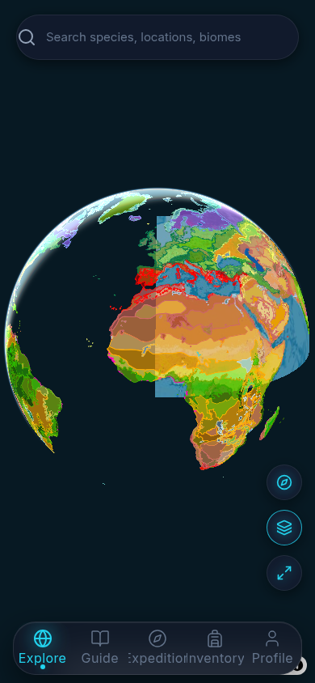
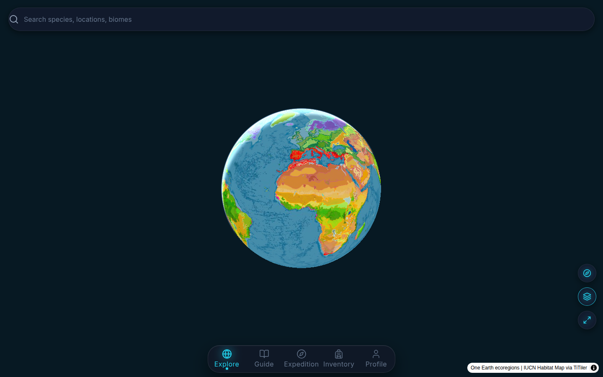
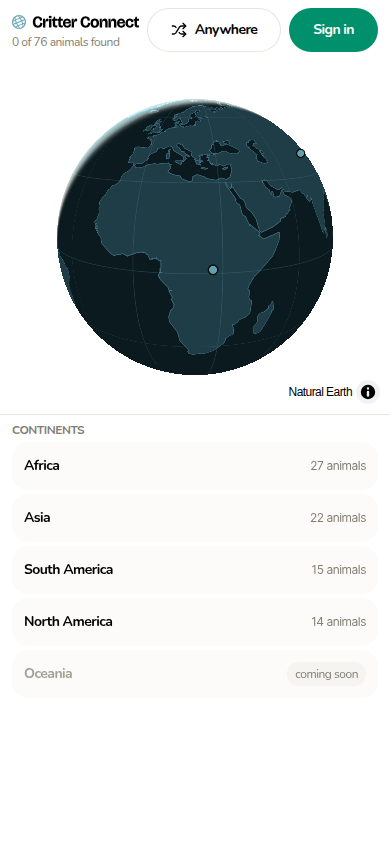
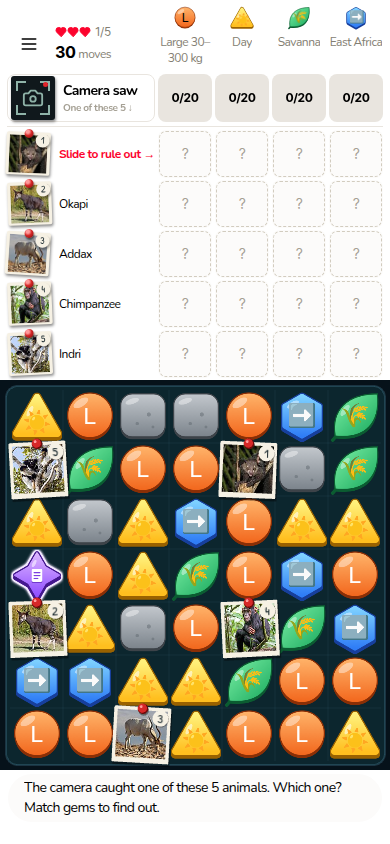
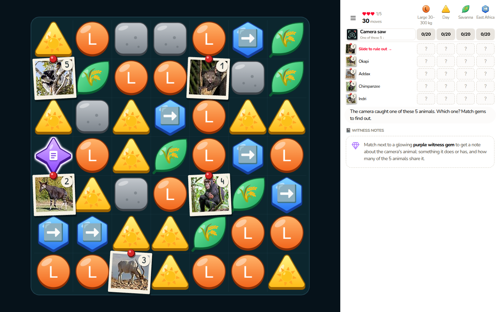

# 051: Website at critterconnect.org

Status: planned. The owner reviews it as a PR; the build starts from [`051-build-brief.md`](051-build-brief.md) once issue #34 is relabelled `ready-for-agent`.
Written by mission [`2026-10-28-cc-landing-plan.md`](2026-10-28-cc-landing-plan.md) (findings, reviews, owner answers H2, decisions). Line refs as of origin/main `acffc179`.

critterconnect.org still serves an old Vercel build of this app ("Explore biodiversity through map-based expeditions", a game that no longer exists). This plan replaces it with a small static site for two audiences, students and teachers, built from this repo's cc theme and served by the Hetzner Caddy next to the game.

| Old site today, 390 | Old site today, 1440 |
|---|---|
|  |  |

## 1. Summary

**Site map** (a static build from `src/site/`, served by the Hetzner Caddy; §3, §10):
- `/`: what the game is in one screen; one primary button, **Start playing** → `play.critterconnect.org`; a mid-page band routes teachers on.
- `/teachers/`: what students do in a round, what they practice (honestly, paper §5), class use with a class link maker, student privacy, sources and limits, coming later, FAQ.
- `/privacy/`, `/terms/`: moved from the game, now scrollable, served on both hosts; `404.html` sends people to play.
- `www` and old game paths 308 to the right place; the Vercel project is deleted a week after DNS moves.

**Coming soon** (only on `/teachers/`, each row "Not available yet:"; §6): a printable teacher guide; a standards map ("maps onto" NGSS, never "aligned to"); class results from a class link, per animal, no names (needs its own plan). Not shown: rosters, class codes, per-student reasoning.

**Skills and cc** (§8): `GUI.md` and the cc tokens are binding, applied with graphical-ui and checked by graphical-audit. Taste shapes composition only (inventory, argument, idea, copy, sections, its gate with `--allow still-page` at 1440/768/390); its art direction, tokens, found pictures and motion are skipped. elaya's Part A gives the intake, the two layouts and the copy rules; Part B is not used. Two owner-approved theme additions: light primary fill `#008663` (4.58:1) and `--space-xxxl: 64px`.

**Open questions** (§12): none blocking; H2 answered the nine. Four defaults the owner can overturn in the PR: the darker fill also applies to the game's buttons; `play.` serves the teacher and legal pages too; a site or Caddyfile change briefly restarts `caddy`; the terms' date moves with the operator sentence.

## 2. Audiences and their jobs

| Audience | Arrives from | Job on the site | Decides on | Main action |
|---|---|---|---|---|
| Student (grades 6–12) | a teacher's link, search, word of mouth | learn what the game is and why it's fun, then start | the first screen: one picture of the real board, one sentence, one button | **Play**: `https://play.critterconnect.org/` (the globe; picking a continent is the game's own first step) |
| Teacher or educator | search, the old domain, a colleague | decide "I'll try this with my class" | what students do in a round, what they practice and how honest the claims are, time (about 5–10 minutes a round), student privacy, cost and setup, what's missing | **Play a round yourself**, then **make a class link** (`/explore/?seed=N`) |

- **A student starts in one click:** the hero's only primary button goes to the globe. Nothing on the site needs an account.
- **A teacher needs**, in order: what a round asks students to do (specific moves, not "engagement"), which skills that practises and what the game doesn't claim, how long it takes, what student data exists, that it's free with no setup, and what's not built yet. All of it is on `/teachers/`, one link from every page.
- **Routing on `/`:** one primary button, Play, for students and for teachers who want to try it. "For teachers" sits in the header at every width and again as a mid-page band; it's never a second hero button (elaya A4; also how PhET, Zooniverse and iCivics route).

## 3. Site map and routing

| Route (apex) | Source → file in `out/site/` | Audience | Job | Main action | Why it earns its place |
|---|---|---|---|---|---|
| `/` | `src/site/pages/Home.tsx` → `index.html` | both | say what it is in one screen; route students to play and teachers to `/teachers/` | Play | the front door |
| `/teachers/` | `src/site/pages/Teachers.tsx` → `teachers/index.html` | teachers | everything a teacher needs to decide: the round in specifics, skills, class use, privacy, sources and limits, coming later, FAQ | Play a round yourself (plus the class link) | teacher content would bury the student path on `/` |
| `/privacy/`, `/terms/` | `src/site/pages/{Privacy,Terms}.tsx`, moved from `src/pages/` → `privacy/index.html`, `terms/index.html` | both | the legal text, now scrollable (today it can't be scrolled on a phone: `globals.css:371-376`) | none | required; already exist |
| any other path | `src/site/pages/NotFound.tsx` → `404.html` | both | send a lost visitor on | Play | people type the old domain's paths by hand |

- **Not pages:** no student page (`/` is it), no "how it works" page (a section on `/`), no "sources" page (a section on `/teachers/`). None would have an action of its own.
- **Both hosts:** `play.` also serves `/teachers/`, `/privacy/` and `/terms/`, the same files (section 10). The legal URLs don't change, and `/teachers/` can be checked live before DNS moves. Every page carries its apex canonical, so the `play.` copies don't compete in search.
- **Links:** between site pages, plain root-relative `<a>` (`/teachers/`), which work on both hosts and in the local preview. On `play.` the wordmark's `/` is the game's globe, which suits that host. Play links are absolute: `https://play.critterconnect.org/`.

## 4. Pages

### Shared roles (every page, light and dark; the build checks both)

| Element | cc role |
|---|---|
| Page ground | `neutral-1` (cte-canvas). Section bands step to `neutral-3` (cte-surface-muted); footer `neutral-2`. Tone steps, not lines or shadows. |
| Section spacing | `py-xxl md:py-xxxl` per section (`xxxl` 64px is new, owner-approved, section 8); inside a section, cc's steps up to `xxl` |
| h1 | `font-brand` heavy, `xl` below 48rem, `xxl` from 48rem; ≤ 32 characters so it stays on two lines at 390 |
| h2, h3 | `font-brand` heavy, `l`; h3 `m` |
| Running text | `font-ui` regular `m` (16/24) in `neutral-10`; secondary text `neutral-8`. Never cte-text-muted (4.04:1). |
| Small text | `s` (14/20): footer, credits, the line under a button. Nothing at `xs`/`xxs`. |
| Actions | `.btn .btn-primary` (at most one per section; light fill `#008663`, section 8), `.btn-secondary`; no `.btn-outline` |
| Links | `neutral-10`, underlined |
| Screenshots | `` with `width`/`height` from `shots.ts` (no layout shift), or `<picture>` for the hero's phone and desktop crops; content-hashed files under `/site/`; radius `m`; hero `fetchpriority="high"`, the rest `loading="lazy" decoding="async"` |
| Fonts | Nunito. Open Runde only for tabular numerals, if any. Patrick Hand not used (it's the cards' handwriting). |
| Motion | none added; cc's control transitions only |
| Not used | colour-1 or colour-4 fields; emoji in markup; eyebrows or pills above headings; 01/02 numbering (use `<ol>`); the globe's "coming soon" chip (3.68:1 at 12px) |

**`src/site/Layout.tsx`** renders the whole document (no `next/head`):
- `<head>`: title, description, canonical, og and twitter tags from the page list in `src/site/config.ts`; `favicon.svg`; the theme-color pair, now exported from `src/lib/theme.ts` (which `_app.tsx` imports too); the game's `THEME_SCRIPT` inline (system mode or a saved pick); the hashed stylesheet.
- A skip link and `<header>`: `Wordmark` → `/`, "For teachers", and a primary "Play" button, in one row at 390 (no menu). `Wordmark` (`src/components/Wordmark.tsx`, new, no Next imports) is the light/dark `` pair moved out of `GlobeScreen.tsx:55-58`, which then uses it too.
- `<main>`.
- `<footer>`: For teachers, Privacy, Terms, Play, `CONTACT_EMAIL` (moved from `LegalPage.tsx` to `config.ts`), "Made by Haunted Pavement LLC", and the photo credits for that page's screenshots.

### Front page `/` (elaya layout A: hero plus sections)

| # | Section (ground) | Job | Headline · key line · action | Picture |
|---|---|---|---|---|
| 1 | Hero (canvas) | what it is; start playing | "Find the animal the camera saw" · "A free game about real animals for grades 6–12. Match gems to answer yes-or-no questions, then rule out the look-alikes until one is left." · **Start playing** · small: "Free. No account, no ads." | `hero-board` (desktop) / `board-phone` (phone) in one `<picture>`, ≥ 1/3 of the first screen on desktop |
| 2 | How a round works (band) | the loop in 3 real steps (`<ol>`) | "How a round works" · 1 "Pick a continent" · 2 "Match gems to answer questions" (20 gems fill a question; 30 moves a round) · 3 "Rule out the look-alikes" (check each animal's field guide; rule out the wrong one and it escapes) | `globe`, `board-phone`, `field-guide` |
| 3 | Keep what you find (canvas) | why keep playing | "Every find goes in your journal" · "Finds glow on the globe. A trail is 5 rounds and 3 hearts." | `globe-found`, `journal` |
| 4 | Real animals (band) | proof, none invented | "{N} real animals, all sourced" (N counted from content at build; 76 today) · "Facts from the IUCN Red List, Animal Diversity Web and other ranked sources. Photos from Wikimedia Commons, credited on every card." | `round-end` |
| 5 | For teachers (canvas) | route teachers | "Teaching grades 6–12?" · "Students compare look-alikes, read real field data and rule out what the evidence excludes. No student accounts. About 5–10 minutes a round." · **See how a class uses it** (secondary) → `/teachers/` | none (text and button, two columns from 48rem) |
| 6 | Final call (band) | repeat the top | "Ready? Pick a continent." · **Start playing** | none |

What the hero and steps show today (live play site, 2026-10-28, reference only; the build retakes every shot, section 9):

| `globe` (390) | `board-phone` (390, seed 1, Africa) | `board-1440` (basis for `hero-board`) |
|---|---|---|
|  |  |  |

### Teachers `/teachers/` (elaya layout B: long-form, answer doubts)

| # | Section | Job | Headline · copy outline | Picture |
|---|---|---|---|---|
| 1 | Hero | what it is for a class | "A deduction game for science" · "Students compare five look-alike animals, read real field data and rule out the ones the evidence excludes. Free, in a browser, no student accounts; about 5–10 minutes a round." · **Play a round yourself** | `grid-marked` |
| 2 | What students do in a round | specifics, not "engagement" | "What students do in a round" · 5 animals, one the camera saw; 30 moves; 4 yes/no questions, each filled by 20 gems; scouting an animal's own answers by clearing gems next to its card; comparing with field guides; ruling out and releasing; a wrong rule-out lets the animal escape and costs a heart; a trail is 5 rounds with 3 hearts; the round-end card shows the full record, family tree, range map and sources | `field-guide` |
| 3 | What they practice | paper §5.1, honestly | "What they practice" · 6 lines condensed from §5.1 (elimination, reading a data table, precise wording like "mostly" and "no record", evidence from text, comparing close relatives, geography and taxonomy); "These map onto NGSS practices (analyzing and interpreting data, argument from evidence) and ideas like MS-LS4-2." Then near verbatim: "The game does not claim to teach these on its own; it gives repeated, low-stakes practice with real data." Plus: "So far tested with simulated players, not yet in a classroom study." | `witness-note` |
| 4 | Using it with a class | how a class uses it | "Using it with a class" · the four §5.5 ideas as four separate short items (think aloud in pairs, debrief losses, a shared seed, extend from the journal); sound starts off. **The live thing:** `ClassLink` makes `https://play.critterconnect.org/explore/?seed=<random 1…4294967295>` in the browser, with a read-only cc text field, a Copy `.btn-secondary` and a live region saying "Copied". Without JS it shows a fixed example link. "Everyone who opens it starts with the same animals." | `round-end` |
| 5 | Student privacy | the privacy page's answer | "Student privacy" · plays fully without an account; no name or email asked; the journal stays in the browser; finished rounds are saved with no link to the player; no ads, tracking cookies or analytics; under 13, ask a parent before signing in; photos load from Wikimedia Commons; → `/privacy/`. No COPPA, FERPA or other legal statements. | none (two columns: without sign-in, with sign-in) |
| 6 | Where the facts come from | trust through honesty | "Where the facts come from" · source tiers (`db/content/sources.json`); every source shown on the round-end card; limits from §5.3: traits are simplified into categories (#4), "no record" doesn't mean "no" (#5), pictures simplify (#3), teachers can't see students' reasoning yet (#11) | `journal` |
| 7 | Coming later (not available yet) | coming soon, labelled | "Coming later: not available yet" · the three rows in section 6, each starting "Not available yet:" | none |
| 8 | Questions teachers ask | FAQ as visible plain Q&A (answer engines, no-JS readers; not collapsed) | "Questions teachers ask" · Is it free? Do students need accounts? What grades? How long is a round? (About 5–10 minutes.) What devices? (Phones and computers, in a browser.) Can the whole class get the same animals? Can I see my students' results? (Not yet; see Coming later.) Is the information accurate? Does it work offline? (No.) | none |
| 9 | Final call | repeat the top | "Try a round, then share a link" · **Play a round yourself** | none |

### Legal pages

- `src/site/pages/Privacy.tsx` and `Terms.tsx` are today's `src/pages/privacy.tsx` and `terms.tsx`, moved; the old files and `src/components/LegalPage.tsx` are deleted. Nothing in the game links to them (`rg -i privacy src` finds only those three files); the URLs keep working through Caddy. Dev preview: `npm run site:serve`.
- Privacy words unchanged. Terms gain one sentence naming Haunted Pavement LLC as the operator, the "we", so their "Last updated" becomes the build's date; their `next/link` becomes `<a href="/privacy/">`.
- `LegalPage` becomes `src/site/LegalArticle.tsx` with the shared roles (h1; "Last updated" in neutral-8; text and underlined links in neutral-10, replacing `LegalPage.tsx:13` colour-1 links and `:16` neutral-7, both 4.03–4.04:1), inside an `<article>`. The layout owns `<main>`, the title and the ground. "← Back to the globe" goes: the header's wordmark and Play cover it.

### 404

`NotFound.tsx` → `404.html`: "This page isn't here" · "The game is one click away." · **Start playing**, in the shared layout.

## 5. Claims and evidence

| Claim | Where it's true |
|---|---|
| Free; plays without an account; no ads, tracking cookies or analytics | `src/pages/terms.tsx` "The game"; `src/pages/privacy.tsx` intro and "What we don't do" |
| For grades 6–12 | `README.md:3`; `docs/ANIMAL_BOARD_PAPER.md` Abstract |
| Five look-alikes, one the camera saw; 30 moves; 4 questions × 20 gems; trail of 5 rounds with 3 hearts | `CONTEXT.md` (Suspect, Mystery animal, Question, Trail); `ANIMAL_RULES` in `src/clueGame/animalBoard.ts:56` |
| About 5–10 minutes a round | the owner's playtests (H2 answer 7; `plans/2026-10-28-cc-landing-plan.md` Decisions) |
| Answers never rule anyone out by themselves; the player compares and rules out; a wrong rule-out lets it escape | `CONTEXT.md` (Answer, Rule out, Escape); paper Abstract |
| Matching without reasoning finds nothing; careful play finds over 90% (simulated players) | paper Abstract and §6; `src/clueGame/animalBoard.ts:50-53` (careful 91–95%); `plans/047-wander.md` |
| Finds glow on the globe and go in the Field Journal; the round-end card has the family tree, range map and sources | `README.md:3`; `docs/CLUE_MATCH.md`; paper §5.2 #5 |
| {N} animals, today 76 (50 mammals, 15 amphibians, 11 reptiles) | `db/content/animals/*.json`, counted by `src/site/render.tsx` at build. Known drift: the game serves the DB, which lags content until the owner runs `npm run content -- build`; the repo's content is still what we vouch for. |
| No continent count | continents come only from the DB (`clue_match_places` view), which a static build can't read, so the copy names no number |
| Facts from the IUCN Red List (all 76), Animal Diversity Web (65) and others in ranked tiers | `db/content/sources.json`; each profile's `sources` |
| Photos from Wikimedia Commons, credited; maps use IUCN and other credited sources | `src/pages/terms.tsx` "Photos and content"; profile `photo` fields |
| The skills practised; "maps onto" NGSS practices and MS-LS4-2; "does not claim to teach these on its own" | paper §5.1 |
| Limits (categories, "no record", pictures, teachers can't see reasoning) | paper §5.3 #3, #4, #5, #11 |
| Classroom ideas | paper §5.5 |
| One link gives the class the same animals and boards | `docs/CLUE_MATCH.md:10` ("`?seed=N` replays a session exactly"); `src/components/animalBoard/useAnimalSession.ts:28-31` (integers 1…4294967295) |
| Privacy facts (no name or email, journal in the browser, rounds saved without a link to the player, under 13) | `src/pages/privacy.tsx` sections |
| Sound starts off; the board plays with a keyboard | `docs/CLUE_MATCH.md:98` ("Once a run"), `:23` (`BoardController.ts` keyboard) |
| Runs in a browser, nothing to install, phones and computers | a web app; desktop rules at 48rem in `src/styles/globals.css`; the build shows it at 390 and 1440 |
| Made by Haunted Pavement LLC | the owner (H2 answer 5; `plans/2026-10-28-cc-landing-plan.md` Decisions); the terms after the build |

**The site never claims:**
- that it teaches on its own or raises scores;
- learning gains (no human study yet, paper §6);
- being "aligned to" standards (it "maps onto" practices, §5.1);
- COPPA or FERPA compliance, or any other legal statement (owner, H2 answer 6);
- dashboards, rosters or class views;
- that a teacher guide, a standards map or class results exist (they're "not available yet");
- offline play;
- any time but "about 5–10 minutes" a round, or any time for a whole trail;
- users, schools, quotes, logos or testimonials (none exist);
- that the photos are its own;
- "mystery", "12 look-alikes" or "charges" (stale `README.md:3`);
- that "rounds are not saved" (stale paper §5.3 #11: every finished round is saved with its `session_seed`, `db/schema.sql` `clue_match_solves`).

**Copy rules:**
- Players read "the one the camera saw", never "mystery".
- Student lines: short and plain, outdoor and tech words; no academic, violent or medical words.
- Teacher lines name what students do.
- Headlines ≤ 32 characters, then one supporting sentence.
- Buttons: a verb plus what you get, never "Learn more".
- Standards: "maps onto", never "aligned to".
- Operator: "Haunted Pavement LLC", exactly.
- No invented numbers: counts come from the content files at build time.

## 6. Coming soon

| Candidate | What it would take | Student privacy, against the privacy page | Show? |
|---|---|---|---|
| Teacher guide (printable: a round walkthrough, §5.5 activities, a debrief sheet for an escape) | writing only | none | **Yes** |
| Standards map (NGSS practices and ideas per activity) | writing plus an expert's review; wording stays "maps onto" | none | **Yes** |
| Class results from a class link: per animal, rounds found or escaped, no names | its own plan first. A seed names a puzzle, not a class or a viewer: anyone with the link could read the results, and strangers on the same seed add to them. Needs a class key separate from the seed and a rule for who may view. Data exists: `clue_match_solves.session_seed` | no new personal data, but rounds get a new use (today: "to see which puzzles are too easy"), so the privacy page gains one sentence when it's built (owner, H2 answer 2b) | **Yes** |
| Class codes and rosters | teacher accounts, a class table, student join codes or nicknames, Clerk organisations or our own | ties play to identifiable students under 13: contradicts "We don't ask for your name or email"; COPPA, FERPA, district agreements | **No** |
| Seeing each student's reasoning (paper §5.3 #11, §5.4) | rosters plus recording marks with the evidence at the time | as rosters, and more data per student | **No** |

The owner confirmed this list (H2 answer 2). On `/teachers/` §7, under the heading "Coming later: not available yet", each shown item is a list row:
- "Not available yet: a printable teacher guide with a round walkthrough and debrief activities."
- "Not available yet: a standards map showing which NGSS practices each activity maps onto."
- "Not available yet: class results from a class link, per animal, with no student names."

`/` shows none of them; the FAQ's "Can I see my students' results?" answers "Not yet" and points to §7.

## 7. Skill intake

**Taste's inputs: what only Critter Connect has** (Taste step 1, the inventory; the build's idea comes from it):

| Item | Where it's real |
|---|---|
| a camera trap, and "the one the camera saw" | `src/components/animalBoard/EvidenceGrid.tsx:18`, the grid's "Camera saw" row |
| polaroid cards on red pins with handwritten numbers | `src/components/animalBoard/AnimalCard.tsx:1`; Patrick Hand in `public/fonts/patrick-hand` |
| five look-alikes from real families (okapi and hirola, aardvark and pangolin) | `db/content/animals/*.json`; `CONTEXT.md` (Suspect) |
| gems whose faces carry the round's questions | `CONTEXT.md` (Clue gem); `src/game/ClueBoardScene.ts` |
| witness notes with blanked words | `CONTEXT.md` (Witness note) |
| ruled-out animals wandering toward the edge, each its own way | `plans/047-wander.md` |
| the globe that glows with your finds; the Field Journal | `src/components/globe/`; `src/components/clueGame/JournalSheet.tsx` |
| the round-end card: family tree, IUCN range map, sources | `docs/CLUE_MATCH.md`; `src/components/clueGame/RangeMap.tsx` |
| 76 animals with sourced facts | `db/content/animals/*.json`, `db/content/sources.json` |

- **The idea** (Taste step 4): on this page, **the real round** becomes **the page's material**. Every section shows the actual screen it describes, cropped large; nothing is drawn or stock. The competitor test holds: no other game has this board.
- **The live thing:** the class link maker on `/teachers/` (§4 row 4).

**elaya A1, answered once per audience:**

| A1 | Student | Teacher | Evidence |
|---|---|---|---|
| Purpose: the one action, the offer, a conversion | Play. The offer: a free round, now, no account. Conversion: a click to `play.` | Play a round yourself, then copy a class link. Offer: a free classroom activity, no setup. Conversion: a click to `play.`, or Copy. | §2, §3 |
| Audience and objections | grades 6–12. "Is it fun?" "Do I need an account?" "Does it work on my phone?" | grades 6–12 science teachers. "What do students actually do?" "What do they learn?" "How long?" "What student data?" "Cost and setup?" "Is it accurate?" "Can I see results?" | `README.md:3`; paper §5; `privacy.tsx` |
| What they know on arrival; traffic source | usually nothing, or a teacher's link | often the old domain or a search | traffic numbers are **the owner's**: no analytics, by policy (`privacy.tsx`) |
| Proof and assets | real screenshots; "free, no account, no ads" | screenshots; {N} sourced animals; source tiers; the paper's honest limits; simulated-player results. No logos, testimonials or users: none exist, none invented. | §5, §9 |
| Guarantees, risk reversal | free, no account | free, no student accounts, nothing to install | `terms.tsx`, `privacy.tsx` |
| Constraints | plain, short, outdoor and tech words; phone first | plain and specific; desktop first, phone works | Brief decision rules; GUI.md |
| Design direction | the cc theme, fixed | same | `GUI.md`, `gui/themes/cc.md` |

## 8. Skills and the cc theme

**Binding:** `GUI.md`, `gui/foundations.md`, `gui/interface-judgment.md` and the cc tokens in `src/styles/globals.css`, applied with **graphical-ui** while building. The build ends with a **graphical-audit** change review of its diff. `npm run lint` runs `scripts/check-theme.mjs`, now over `src/site` too.

**Per section** (every page follows the game's mode, system or a saved pick, through `THEME_SCRIPT`; every role below has a light and a dark value in `globals.css`, and `e2e:site` checks both; screenshots stay light-mode in both, H2 answer 8):

| Page · section | cc components and roles |
|---|---|
| all · header | `Wordmark` light/dark `` pair; "For teachers" link (neutral-10, underlined on hover and focus); Button primary "Play" |
| all · footer | `neutral-2` ground; links neutral-10 underlined; text `s` neutral-8; credits `s` |
| `/` 1 Hero | canvas `neutral-1`; h1 `font-brand` heavy `xl`/`xxl`; key line `m` neutral-10; Button primary; small line `s` neutral-8; `<picture>` radius `m` |
| `/` 2 How a round works | band `neutral-3`; h2 `l`; `<ol>` of three, each h3 `m`, one line, one shot; no cards (tone steps, not borders) |
| `/` 3 Keep what you find | canvas; h2, line, two shots |
| `/` 4 Real animals | band; h2 with {N}; line; one shot |
| `/` 5 For teachers | canvas; h2, line; Button secondary; two columns from 48rem |
| `/` 6, `/teachers/` 9 Final call | band (`/`) or canvas (`/teachers/`); h2; Button primary |
| `/teachers/` 1 Hero | canvas; h1; line; Button primary; shot |
| `/teachers/` 2, 3, 6 | alternating band and canvas; h2; `<ul>` in `m` neutral-10; the paper's sentence as `<blockquote>` in neutral-10; one shot each |
| `/teachers/` 4 Using it with a class | band; `<ol>`; `ClassLink`: cc **Text field** (read-only), Button secondary "Copy", `aria-live` line `s` neutral-8 |
| `/teachers/` 5 Student privacy | canvas; two columns, each an h3 `m` and a `<ul>`; link to `/privacy/` |
| `/teachers/` 7 Coming later | band; `<ul>`; "Not available yet:" as bold text in the row, never a chip |
| `/teachers/` 8 Questions teachers ask | canvas; each question an h3 `m`, the answer a `<p>`; not an Accordion (visible, §4) |
| legal pages, 404 | `LegalArticle` (§4): h1, "Last updated" neutral-8, text and links neutral-10 |

The only mode-specific value is the primary fill: light `#008663`, dark `#00906c`.

**Taste** (`design-taste-frontend`, v2.1.5, commit `12af471f62`; composition only):
- **Used:** step 1 inventory (§7), step 2 the argument (claims become sections: §4's tables), step 4 the idea (§7), step 5 copy rules (`references/copy.md`), steps 6.2–6.9 (hero, sections, imagery, fullness, frame, semantics), mapped onto the cc roles above. Step 8: look, plus `references/critique.md`, three rounds at most. Step 10: the report.
- **The gate:** `lint.mjs` on `src/site/`, and `inspect.mjs --allow still-page` on the **built** site (`npm run site:serve`) at 1440, 768 and 390, on `/` and `/teachers/`. `still-page` is the only allowance: the brief bars motion, and the inspector fails a page with fewer than 8 moving elements (`inspect.mjs:231-234`).
- **Skipped:** step 3 `draw.mjs` (art direction), 6.1 tokens (cc's), `assets.mjs` (found pictures: the game's own screens exist), scroll scenes, step 9 motion, `base.css`. Legal pages don't go through Taste.
- **Changed since the brief:** the skill's folder is `skills/taste-skill/` (its name is `design-taste-frontend`); v2.1.5 of 2026-10-25.

**elaya Part A taken** (`skills/landing-page-design/SKILL.md`, last changed `a2735a3eaf`, 2026-10-26; it now credits Taste):
- A1 intake (§7).
- A2: above the fold items 1–3 and 5; item 4's proof signal becomes a true fact line ("Free. No account, no ads."), not logos. How it works in three steps; a FAQ on `/teachers/`; a final call like the top. Social proof skipped: none exists. The B11 "tagline reveal" A2 asks for is Part B, so not used.
- A3: layout A for `/`, B for `/teachers/`. A4: one primary action, specific, proof beside the claim, objections as a section. A5: headline and button formulas. A6: section-by-section build order. A7: index both pages, title and meta, internal links, FAQ as plain Q&A. A8: pitfalls as a checklist.
- Part B (fonts, scales, radii, motion, nav, B11) is not used.

**Theme gaps, settled by the owner (H2 answers 3 and 4):**
1. `--button-primary-background`: light `#008663` (white label 4.58:1; `#00906c` gives 4.03:1, AA needs 4.5:1), dark stays `#00906c` (label 4.67:1). Same OKLCH hue and chroma. It applies to every light-mode `.btn-primary`, the game's too, so the two don't drift (default 1, §12).
2. `--space-xxxl: 64px` with `--spacing-xxxl`, the next step on cc's 4px scale, used only as section padding `py-xxl md:py-xxxl`. The h1 stays `xxl` 48px, led by a large real screenshot (Taste's `focal-point`: a picture ≥ 30% of the first screen).

Each carries a comment in `globals.css` citing plan 051 and H2; graphical-audit reports them as intentional local changes. No other gap was found. A new one goes to the handoff file with a default, as GUI.md says.

## 9. Assets

| Name | Shows | In `051-landing-page/` now | The build takes it | Used on |
|---|---|---|---|---|
| `old-site` | critterconnect.org before the switch, 390 and 1440 | `old-site-390.png`, `old-site-1440.png` | no (record only) | this plan |
| `globe` | the globe with its continent list | `globe.png` (live, 390) | 390×844 @2x, game production build, headless | `/` 2 |
| `board-phone` | round start, seed 1, Africa | `board-phone.png` (live, 390) | 390×844 @2x, production build | `/` 1 (phone), 2 |
| `hero-board` | round start on desktop | `board-1440.png` (live, basis) | 1440×900, production build; cropped to 1200×630 for `og.png` | `/` 1 (desktop); `og.png` |
| `field-guide` | an animal's field guide open | no | 390×844 @2x, `npm run e2e` seeded | `/` 2, `/teachers/` 2 |
| `grid-marked` | answers in the grid plus a rule-out | no | e2e seeded | `/teachers/` 1 |
| `witness-note` | a witness note | no | e2e seeded | `/teachers/` 3 |
| `round-end` | the round-end card | no | e2e seeded, or `window.__cc` if the VPS run stops early | `/` 4, `/teachers/` 4 |
| `journal` | the Field Journal | no | as `round-end` | `/` 3, `/teachers/` 6 |
| `globe-found` | finds glowing on the globe | no | as `round-end` | `/` 3 |

- **Plan PNGs are reference only.** They come from the live play site on 2026-10-28 (production: no dev badge, no DB writes). The build retakes every site shot from the game as it is then, in light mode, because each needs a seed, its animal ids and their credits.
- **How:** production build (`npm run build && npx next start -p 3100`) for round-start shots. Dev e2e for the rest, after two small `scripts/e2e.mjs` edits: `screenshot()` removes `nextjs-portal` (the dev badge) first, and a `02d-field-guide.png` shot while the guide is open (~l.345). The round-end, journal and globe-found shots need a finished round, which this plan mission couldn't take (a finished round writes to the DB).
- **Shot list:** `src/site/shots.ts` records each shot's file, width, height, alt text, seed, place and the animal ids visible, copied from the run's `report.json` (or the `__cc` session) and checked by eye on every retake. Shots are committed as WebP in `src/site/shots/`, converted once with the installed `sharp`.
- **Logos:** the served `public/branding/critterconnect-logo{,-light}.svg` (light: `#000`/`#6FA8BC`, H2 answer 8) and `public/favicon.svg`, copied by the build to the same paths. Not `docs/brand/logo/` directly: the served pair is the same artwork with a tight viewBox and the light recolour. No app icon. `og.png` stays PNG (some scrapers reject WebP), at `src/site/og.png`: `.dockerignore`'s `*.png` matches root-level files only.
- **Photo credits:** Commons photos keep their own licences (today 24 CC BY-SA 4.0, 18 CC BY-SA 3.0, 9 CC BY 2.0, 8 public domain, others; 2 animals have no photo). `src/site/render.tsx` reads the visible animals' `photo.credit/license/page` with `readProfiles` (moved from `scripts/content.ts:23` to `src/lib/contentProfiles.ts`) and prints one line per photo in that page's footer. The build fails if a shot lists an animal with no profile. Where seeds allow, prefer animals whose photos are public domain or CC BY. No other licence statement (H2 answer 6).

## 10. Hosting and shipping

**Chosen: (b), a separate static build** (owner, H2 answer 1). Source in phaser-june under `src/site/`; the Hetzner Caddy serves it for `critterconnect.org` and `www`, replacing the Vercel app.

| | (a) pages in the game's Next app | (b) separate static build (chosen) |
|---|---|---|
| Theme | `globals.css` already | `globals.css` imported at build, never a copy |
| Clerk, framework JS | on every page (`_app.tsx:11`), ~80 KB gz Clerk React stays | none |
| Scroll lock (`globals.css:371-376`) | needs an opt-out inside the game | the site's CSS overrides it |
| Coupling | site deploys and breaks with the game's process | Caddy serves files; the game can be down |
| Cost | a host rewrite in `proxy.ts` | a build script, a Docker stage, a Caddy block |

**Build approach** (nothing new installed):

| | React to HTML with esbuild, postcss, Tailwind (chosen) | Next static export, second project | Tailwind CLI with partials, Astro, Eleventy |
|---|---|---|---|
| Header, footer, legal text | one `Layout`, the moved legal components, `Wordmark` shared with the game | same | hand-copied partials, or a new templating tool |
| New tooling | none | export can't share the game's project (API routes, redirects, headers, proxy unsupported: `node_modules/next/dist/docs/01-app/02-guides/static-exports.md`): a second config, pages folder, Turbopack root | a new dependency |
| JS shipped | two small inline scripts | React and Next's runtime | none |

Proven on 2026-10-28 in `/tmp`: an entry CSS that `@import`s `globals.css` compiles with `@tailwindcss/postcss` (`base` = the site folder: fonts, tokens and `.btn` come in, the game's utilities stay out; 20 KB, 5.4 KB gz); esbuild bundles a TSX page using `@/` paths and `renderToStaticMarkup` renders it; `scripts/run-typescript.mjs` can't run it (Tailwind's native modules can't be bundled), so the build is a plain `.mjs` like `scripts/run-tests.mjs`.

- **Source** `src/site/`: `config.ts` (`SITE_URL`, `PLAY_URL`, `CONTACT_EMAIL`, `OPERATOR`, the page list), `Layout.tsx`, `LegalArticle.tsx`, `ClassLink.tsx` + `classLink.client.ts`, `pages/{Home,Teachers,Privacy,Terms,NotFound}.tsx`, `render.tsx`, `shots.ts`, `shots/*.webp`, `og.png`, `site.css` (`@import "../styles/globals.css"`, `@source "../components/Wordmark.tsx"`, then `html, body { height: auto; overflow: visible }`).
- **Build** `scripts/site.mjs` (`npm run site:build`) into `out/site/` (already git- and ESLint-ignored): empty it; compile `site.css` (minified, content-hashed, to `/site/`); bundle `classLink.client.ts` inline; copy shots and `og.png` to `/site/` hashed; run `render.tsx` and write `index.html`, `teachers/index.html`, `privacy/index.html`, `terms/index.html`, `404.html`; copy `public/fonts/`, the wordmarks and `favicon.svg` to the game's paths; write `robots.txt` and `sitemap.xml`. Deterministic: no dates, no random values (the class link's seed is made in the browser).
- **Preview:** `npm run site:serve` = `python3 -m http.server 3101 -b 127.0.0.1 -d out/site` (like `npm run docs`). Preview, `e2e:site` and Taste all use it.
- **Guards:** `eslint.config.mjs` `no-restricted-imports` in `src/site/**` (`next`, `next/*`, `@clerk/*`); `check-theme.mjs` adds `src/site` to `ROOTS`, and `_app.tsx` leaves `HEX_ALLOWED` once its hexes move to `src/lib/theme.ts`; CI (`.github/workflows/ci.yml`) runs `npm run site:build`, `docker build --target caddy`, then `caddy validate` and a check for `/srv/site/index.html` inside that image (Docker isn't on the agents' VPS, so CI is where the image is proven); `tsc` already covers `src/site`.
- **Into Caddy's image** (`Dockerfile`): the first stage's `npm ci` + `COPY . .` become `deps`; `build` (unchanged from `ARG` on) and a new `site` stage (`npm run site:build`, no Clerk key needed) start `FROM deps`; a new `caddy` stage `FROM caddy:2` copies `deploy/Caddyfile` and `/app/out/site` to `/srv/site`; `run` stays last. `deploy/docker-compose.app.yml`: `app.build.target: run`; `caddy` swaps `image: caddy:2` for `build: { context: ., target: caddy }` and drops the Caddyfile bind mount (today's single-file mount, `:33`, is why Caddyfile edits never apply). `deploy.sh`'s `build -q` and `up -d` then recreate `caddy` only when its image changed, with no script state.
- **`deploy/Caddyfile`** (the apex is hardcoded, so a missing variable can't break the game's block; validated on Caddy 2.11.7 and behaviour-tested locally with `*.test` hosts, a stub upstream and a scratch site, 2026-10-28):
  ```
  (common) {
  	encode zstd gzip
  	header {
  		Strict-Transport-Security "max-age=31536000"
  		X-Content-Type-Options nosniff
  		Referrer-Policy strict-origin-when-cross-origin
  		-Server
  	}
  }
  # The website (plan 051): static files built into the caddy image (Dockerfile, stage caddy).
  (site) {
  	root * /srv/site
  	header /site/* Cache-Control "public, max-age=31536000, immutable"
  	file_server
  }
  {$APP_DOMAIN} {
  	import common
  	@site path /teachers /teachers/* /privacy /privacy/* /terms /terms/* /site/*
  	handle @site {
  		import site
  	}
  	handle {
  		reverse_proxy app:8080
  	}
  }
  critterconnect.org {
  	import common
  	@game path /explore /explore/* /login /login/* /clue-match /clue-match/* /api/*
  	redir @game https://{$APP_DOMAIN}{uri} 308
  	import site
  	handle_errors 404 {
  		rewrite * /404.html
  		file_server
  	}
  }
  www.critterconnect.org {
  	redir https://critterconnect.org{uri} 308
  }
  ```
  Local results: apex `/`, `/teachers/`, `/privacy/` 200, `/teachers` 308 to `/teachers/`, `/nope/` 404 with `404.html`; `/explore/?seed=5` and `/api/places/` 308 to `play.` with the query kept; on `play.`, `/` and `/explore/` reach the app while the site paths come from files; `www` 308 to the apex; `/site/*` immutable; security headers once each. `handle_errors` can't sit inside `handle`, so the 404 page is apex-only.
- **`deploy/deploy.sh`:** the remote part is unchanged (pull, `build -q`, `up -d`, health wait). The local curl loop after it becomes `bash deploy/check.sh`, and the deploy exits non-zero if that fails.
- **`deploy/check.sh`** (new; prints `OK`/`BAD` per line, exits 1 on any `BAD`):
  - `play.`: today's four routes 200; `/teachers/`, `/privacy/`, `/terms/` 200 and linking `/site/site.`; every `/site/…` URL in `/teachers/` 200 with its type (the images are in the image before DNS moves).
  - apex, only once `getent hosts critterconnect.org` resolves to `play.`'s IP (else one line: "DNS not moved yet, skipped"): the four pages 200 with the apex canonical and no `<script src`; every `/site/…` URL in `/` 200; `robots.txt`, `sitemap.xml` 200; `/nope/` 404; `/explore/?seed=1`, `/api/places/` 308 to `play.`; `www…/teachers/` 308 to the apex.
- **Owner's steps after merging the build PR** (from WSL, as `docs/DEPLOY.md` "Start and update"):
  1. Optional, a day before: Namecheap TTL of `@` and `www` to 300.
  2. `npm run deploy`. `play.` serves `/teachers/`, `/privacy/`, `/terms/` from the site at once; `check.sh` skips the apex. Until step 4, `docker logs caddy` shows ACME errors for the apex and `www`: expected, not a reason to roll back. Do step 3 the same day.
  3. Namecheap → critterconnect.org → Advanced DNS: `@` A from `216.198.79.1` to `178.156.159.183`; `www` CNAME to `critterconnect.org.`. Leave MX (email forwarding, carries `privacy@`), TXT (SPF) and `clerk` alone.
  4. On the VPS, `docker restart caddy` to request the certificates now.
  5. `bash deploy/check.sh`: every line `OK`, apex included.
  6. **Vercel:** remove both domains from the old project now; **delete the project one week after step 3** (H2 answer 2c; its environment holds a Clerk dev key, `pk_test`).
  - Rollback: restore the two DNS records (possible during that week). A bad site build: `git revert`, `npm run deploy`.
- **Old links:** `www.*` 308 to the apex; `/` gets the new front page (the old site had only `/`); `/explore*`, `/login*`, `/clue-match*`, `/api/*` 308 to `play.` with path and query; anything else the 404 page with Play.

## 11. Basics

Checked by `scripts/e2e-site.mjs` (`npm run e2e:site`, `E2E_SITE_URL` default `http://localhost:3101`) on the served build at **390×844 and 1440×900, light and dark**, on `/`, `/teachers/`, `/privacy/`, `/terms/`, `/404.html`. It reuses the CDP client and Chrome launcher, moved from `scripts/e2e.mjs:45-90` into `scripts/cdp.mjs`. Artifact: `e2e-artifacts/<run>-site/report.json` plus `site-<page>-<width>-<mode>.png`, with the command to reproduce.

- **Accessibility:** WCAG 2.1 AA. axe-core (declared devDependency, pinned `4.11.0`, loaded with `createRequire(...).resolve('axe-core/axe.min.js')`, never shipped) for wcag2a/2aa/21a/21aa: **0 violations, no exceptions**. Plus: one h1; landmarks and a skip link; visible focus (the existing `:focus-visible`); keyboard order; alt on every shot; no text under 14px; the document scrolls to the footer.
- **Speed** (390, 4× CPU slowdown, Slow 4G 1.6 Mbps/150 ms, `/` and `/teachers/`): LCP ≤ 2.5 s, CLS ≤ 0.1; ≤ 300 KB on first load (about 6 KB gz CSS, 49 KB Nunito in three weights, wordmarks, hero WebP); no JS beyond two inline scripts (< 2 KB); no `<script src`; no requests to other hosts; no console errors. Measured once by a short CDP script in the build's artifacts.
- **SEO:** a title and description per page, from `config.ts`; `lang="en"`; apex canonical on both hosts; og and twitter tags with an absolute apex `og.png`; `robots.txt` with `Sitemap:`; `sitemap.xml` with the 4 apex URLs; the 404 answers 404. Checked by `e2e:site`, then through Caddy by `deploy/check.sh`.
- **The class link:** two loads give two different `https://play.critterconnect.org/explore/?seed=N` links (N integer, 1…4294967295); Copy fills the clipboard and the live region says "Copied"; with JS off the fixed example shows. That a seed replays the same round is already `npm run e2e`'s check.
- **Old title and description → new:**

| | Old (critterconnect.org today) | New |
|---|---|---|
| `/` title | "Critter Connect" | "Critter Connect: a free animal deduction game for grades 6–12" |
| `/` description | "Explore biodiversity through map-based expeditions." | "Find the animal the camera saw. Match gems to answer questions, then rule out the look-alikes. Free, no account." |
| `/teachers/` title | none | "Critter Connect for teachers: free, no student accounts" |
| `/teachers/` description | none | "What students do in a round, what they practice, student privacy, and how to give a class the same animals." |

## 12. Questions for the owner

**Answered** (handoff H2, 2026-10-28):
1. Hosting: (b), a separate static build served by the Hetzner Caddy; theme imported, never copied; no Clerk.
2. Coming soon: teacher guide, standards map ("maps onto"), class results by class link with no names, each "not available yet"; no rosters or student accounts. (b) The privacy page gains one sentence when class results are built. (c) Delete the Vercel project a week after the DNS move.
3. Contrast: darken the primary fill only, to pass AA: `#008663`, 4.58:1, light mode.
4. Spacing: add one step, `--space-xxxl: 64px`; h1 stays `xxl` with a large screenshot; no motion.
5. Operator: Haunted Pavement LLC, in the footer and the terms.
6. Legal (Clerk script, photo credits, COPPA/FERPA): the site makes none of these claims.
7. Round length: about 5–10 minutes.
8. Brand: light-mode screenshots; the served light wordmark.
9. Stale docs: the build fixes `README.md:3` and dates a note under paper §5.3 item 11.

**Defaults the redesign set**, none blocking (so none is in the handoff file); overturn any in the PR:
1. The darker primary fill applies to every light-mode `.btn-primary`, the game's included.
2. `play.` also serves `/teachers/`, `/privacy/` and `/terms/`: the same files, with the apex canonical.
3. A deploy that changes the Caddyfile or the site recreates the `caddy` container: a few seconds' blip for the game, only then.
4. The terms' "Last updated" moves to the build's date, because the operator sentence changes them.
